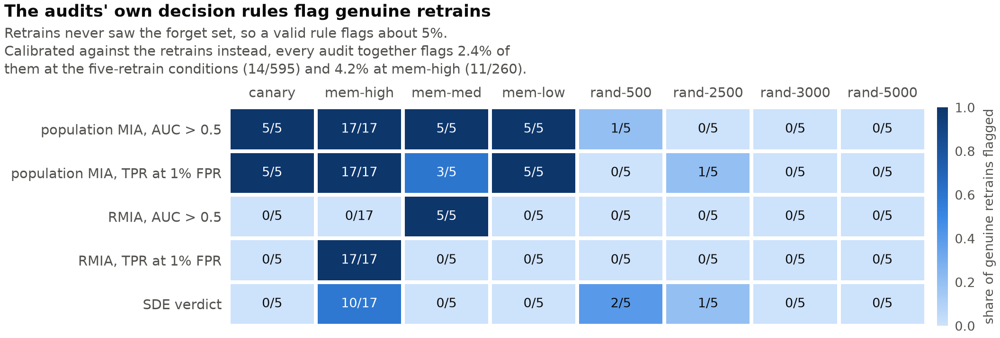

# ForgetCheck

**Audit disagreement, reversibility and audit validity in approximate machine unlearning.**

When different audits disagree about whether an unlearning method worked, which audit is right —
and does the answer depend on how hard the deletion request is?

ForgetCheck answers this on CIFAR-10 with ResNet-18: five unlearning methods and a destructive
control, eight forget sets of controlled difficulty, five seeds, and six audit families, every one
of them checked against models retrained from scratch without the forget set. The study is
complete. [`docs/RESULTS.md`](docs/RESULTS.md) gives every result with the reasoning behind it.

---

## Main findings

1. **An audit's own decision rule cannot be trusted on realistic forget sets.** Genuine retrains
   never saw the forget set, yet the population membership attack's rule ("AUC above 0.5 means
   the data leaks") calls 17 of 17 of them leaking on the most-memorized set. The attack detects
   that the forget set differs from test data, not membership.
2. **Calibrated against genuine retrains, the audits work.** Judged against leave-one-out retrain
   bands, the audits flag 2.4% of retrains (14 of 595) at the five-retrain conditions and 4.2%
   (11 of 260) at mem-high, against a nominal 2.3–4.6%, and they still detect the original models.
3. **"Unlike a retrain" is not "remembers".** A destroyed model is unlike a retrain too. Read with
   a utility guard, 23 of 39 audit readings classify the canary condition, where residual memory
   is known, perfectly; 19 of them only because of the guard.
4. **Outside the negative control, no unlearned model passes every calibrated audit** (0 of 175
   healthy models), and the audits disagree about which method forgets best. SalUn and NegGrad+
   look the most retrain-like to the strong attack (RMIA) and to relearning, and the least to
   behaviour and representation.
5. **Models whose representations stay closer to the original relearn faster** (within-condition
   Kendall τ +0.64), whichever method produced them, and **audits agree most where memorization
   is strongest**, the opposite of the disagreement hypothesis.



## The study at a glance

| | |
|---|---|
| **Data and model** | CIFAR-10, ResNet-18 |
| **Models** | 10 originals (5 seeds, each on clean and on canary labels) · 52 retrains (5 per forget set, paired with an original by seed, plus 12 independent ones at mem-high) · 32 RMIA reference models · 240 unlearned models |
| **Forget sets** | `mem-high`, `mem-med`, `mem-low` (3,000 examples each, by memorization score; `mem-low` is the negative control) · `rand-500`, `rand-2500`, `rand-3000`, `rand-5000` (nested random sets) · `canary-500` (examples given a wrong label before training: the ground truth) |
| **Methods** | Fine-tuning, L1-sparse, NegGrad+, SalUn, SCRUB, plus NegGrad (unbounded gradient ascent) as the destroyed control |
| **Audits** | Behaviour (JS divergence to the retrains) · population membership inference · RMIA · representation (linear CKA) · relearning · SDE (a retrain-free independence test, secondary). 37 registered metrics in all |
| **Verdicts** | Each audit gives two: its **native rule**, as practitioners use it, and a **calibrated** one, against a 95.45% prediction band of genuine retrains. Each is scored for false-positive rate (on retrains), power (on originals) and correctness (on the canary) |

## Start here

| If you want to… | Read |
|---|---|
| See the results and the reasoning behind every number | [`docs/RESULTS.md`](docs/RESULTS.md) |
| Explore the results interactively, or present them | [`dashboard/`](dashboard/README.md) |
| Know how the build went: decisions, defects and corrections | [`docs/STATUS.md`](docs/STATUS.md) |
| Build or change something | [`docs/IMPLEMENTATION_PLAN.md`](docs/IMPLEMENTATION_PLAN.md) — §4 is **binding** |
| Understand why the design is what it is | [`docs/FORGETCHECK_REVIEW.md`](docs/FORGETCHECK_REVIEW.md), with the evidence in [`docs/RESEARCH_LOG.md`](docs/RESEARCH_LOG.md) |
| Cite the science, or describe the project | `ForgetCheck_Master_Project_Reference.docx` (v3.0), the single source of truth |

[`docs/README.md`](docs/README.md) indexes every document.

## Setup

```bash
python -m venv venv
venv/Scripts/activate              # Linux/macOS: source venv/bin/activate
pip install -e ".[dev,dashboard]"
pytest                             # 607 tests, on synthetic data shaped like the real data
pytest -m slow                     # 27 more: real training and audit runs, and every dashboard page
```

CIFAR-10 downloads on first use. The memorization scores are committed
(`data/memorization/`, 400 KB).

## Reproducing the results

**From a results bundle (CPU, any machine).** Unzip `forgetcheck_stage8_results (4).zip` into the
repository root, so that `results/calibration/` and `results/analysis/` are filled (both are
gitignored). Then:

```bash
forgetcheck --root . analyse       # recomputes every analysis table from results/calibration/
forgetcheck --root . figures       # redraws the figures into results/figures/
```

The analysis is deterministic (bootstrap seed 300, 10,000 resamples) and reproduces the bundle's
tables exactly.

**From scratch (Kaggle GPU).** Training, unlearning and the audits run on Kaggle; notebooks are
in [`notebooks/kaggle/`](notebooks/kaggle/). Run `00_verify_setup.ipynb` first.

| Stage | Work | Notebook | Command | Cost |
|---|---|---|---|---|
| 0–2 | Environment, registry, forget sets | `00_verify_setup` | `status`, `forget-sets` | minutes |
| 3 | Original models and retrains | `01_train` | `queue --stage 3` | 62 trainings, ~8 GPU-hours |
| 4 | RMIA reference models | `02_shadows` | `queue --stage 4` | 32 trainings |
| 5 | Unlearning | `03_unlearn` | `queue --stage 5` | 240 runs, ~12.6 GPU-hours |
| 6 | The audits | `04_audit` | `audit` | 240 models × 6 audits |
| 7 | Calibration and audit validity | `05_calibrate` | `audit`, `calibrate`, `diagnose-twins` | GPU, one account |
| 8 | Analysis and figures | `06_analyse` | `original-similarity`, `calibrate`, `analyse`, `figures` | GPU for step 0, then CPU |
| — | Relearning curves, for the dashboard | `07_curves` | `relearn-curves` | 1–3 GPU-hours |

Every command is `forgetcheck <command>`; add `--dry-run` to list the work without running it.

`queue` is what makes several Kaggle accounts usable at once. It enumerates a stage's work, takes
this account's stripe, and skips anything already in the store. Run identifiers are pure functions
of the config, so every account derives the identical list and no two are given the same item —
with no coordination between them.

```bash
forgetcheck --dry-run queue --stage 3 --account 1 --of 3   # list this account's share
forgetcheck --device cuda queue --stage 3 --account 1 --of 3
```

### Kaggle datasets

Create them once and attach them to the notebooks via **Add Input → Datasets**:

| Dataset | What | Why |
|---|---|---|
| `forgetcheck-cifar10` | the extracted `cifar-10-batches-py` | CIFAR downloads slowly on Kaggle, on every session and account. The hash in `configs/base.yaml` is of this exact torchvision-format download |
| `forgetcheck-artifacts` | `artifacts/` + `results/` from stages 3–5 (~14 GB of checkpoints) | Lets a session skip runs another account already finished, and gives the audits every checkpoint |
| `forgetcheck-stage6` | the audit records and cached outputs | Needed by notebooks 05–07. Attach it at its **latest** version |

`00_verify_setup.ipynb` has a cell that stages CIFAR for upload.

## Dashboard

```bash
streamlit run dashboard/app.py
```

A guided tour of the findings for presentations, a report card for any of the 240 unlearned
models, audit validity, agreement between audits, method comparisons, relearning curves, the forget
sets, and a calibration lab for what-ifs (band size, band rule, damage threshold, minimum effect).
It runs from its own committed snapshot in `dashboard/data/`, so it needs no results bundle. See
[`dashboard/README.md`](dashboard/README.md).

## Layout

```
src/forgetcheck/
  registry/     ids · metrics · records · store · provenance             BINDING (plan §4)
  data/         cifar · forget_sets · memorization
  models/       resnet                                                   CIFAR ResNet-18 + GAP taps
  evaluation.py                                                          shared by training and audits
  train/        loop · tasks                                             the ONE training loop
  unlearn/      base · methods · runner                                  six methods, one interface
  audits/       behavioral · privacy_population · privacy_rmia ·         Stage 6
                representation · relearning · sde · probes · runner
  calibrate/    bands · native · canary · twins · report                 Stage 7
  analysis/     agreement · mixed_effects · figures · report             Stage 8
  config.py · cli.py
configs/        metrics.yaml (the direction commitment) · base.yaml · audits.yaml
notebooks/kaggle/   00–07, generated by _build.py
dashboard/      Streamlit app · prepare_data.py · data/ (committed snapshot)
docs/           results, status, plan, review, research log, figures/
tests/
```

## Design commitments

These are not incidental; results depend on them.

**One training loop.** Originals, retrains and reference models all go through it unmodified. If
a retrain were trained under a different schedule than its original, the gap between them would
contain a schedule difference as well as a forget-set difference, and no audit could separate the
two.

**Metric direction is fixed before results exist.** `configs/metrics.yaml` commits in advance to
what "better" means for all 37 metrics, and `validate()` rejects any unregistered name on write.
Deciding direction after seeing results is p-hacking. Forget-set accuracy, in particular, is
`closer_to_oracle`, not `lower_better`: a retrained model still classifies most forgotten examples
correctly, so driving it to zero is over-forgetting, not success. The naive "lower is better"
ranking puts the destroyed model first; measured against retrains, it is last.

**The retrain is a distribution, not a model.** Retrains differ from each other because training
is random, so a single retrain is not "the" answer. A verdict asks whether a model falls outside a
95.45% prediction band of retrains (mean ± t·s·√(1 + 1/n), valid with as few as five), and an
audit's false-positive rate is measured leave-one-out on the retrains themselves. A threshold that
a genuine retrain fails is a broken threshold, not a strict one.

**Every audit is checked against known answers before it is believed.** Retrains are known
negatives (false-positive rate), the originals are known positives (power), and the canary
condition is ground truth: only memorization can fit a wrong label, so residual memory is
measured directly.

**Forgetting is read next to utility.** A model more than 5 points of test accuracy below the
retrains is reported as damaged, not forgotten. The destroyed control looks private to the
retrain-free audits while being useless.

**Three independent seed streams** (`train`, `oracle`, `audit`) are never shared, because mixing
them silently couples effects the analysis assumes independent.

**Records are append-only Parquet shards, one per run.** Never a shared CSV: concurrent Kaggle
sessions writing one file is guaranteed corruption, discovered late.

## Status

Complete: every stage has passed its gate, and the dashboard is built. The build diary, with every
decision, defect and correction, is [`docs/STATUS.md`](docs/STATUS.md).
