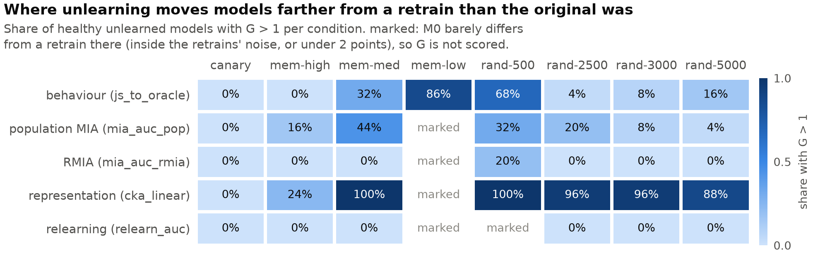
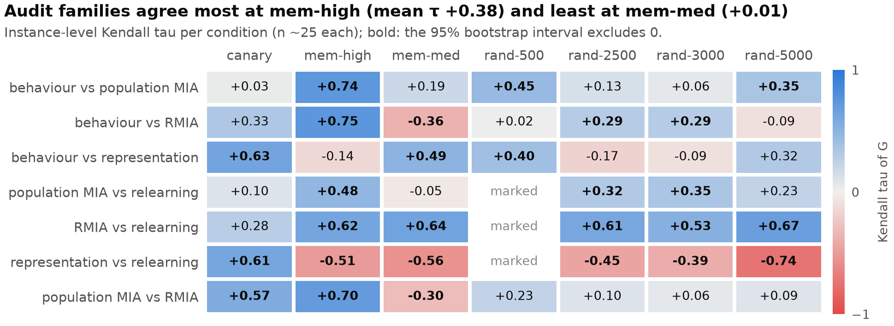
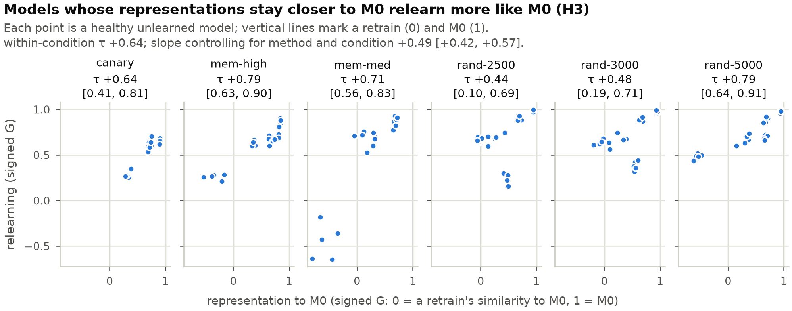
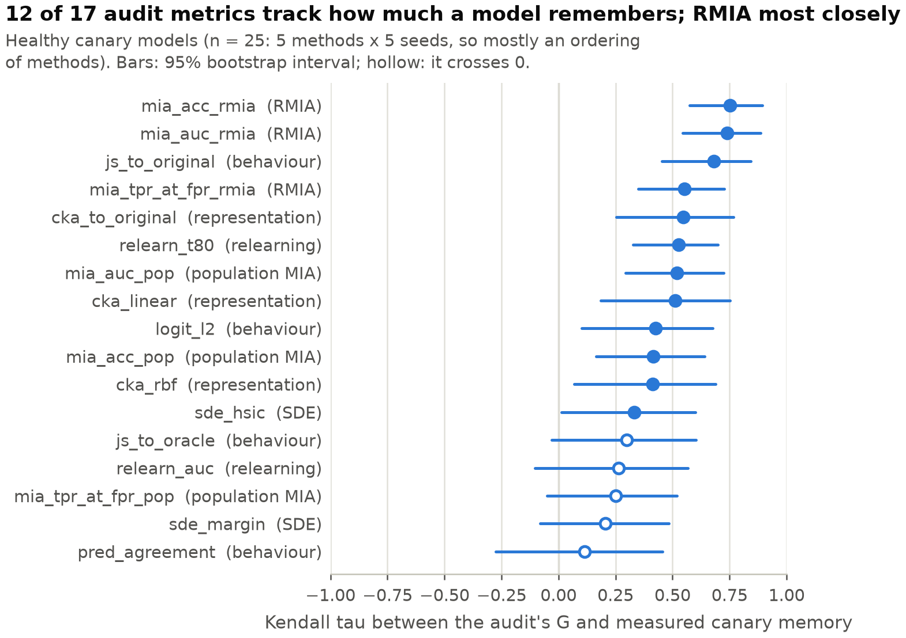
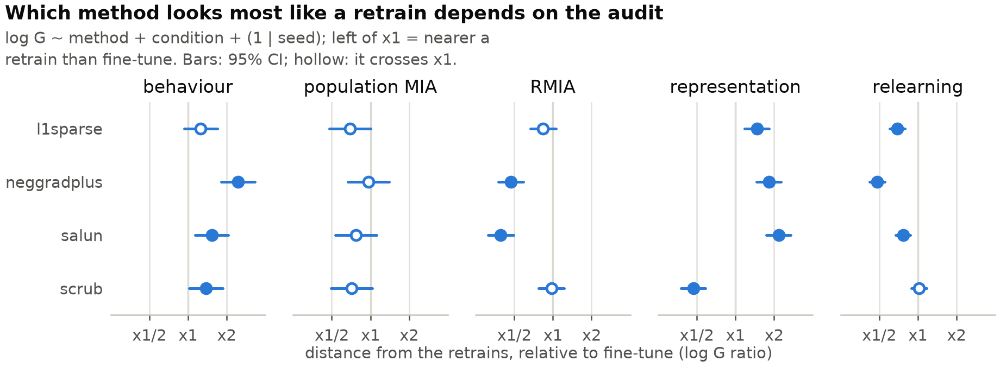
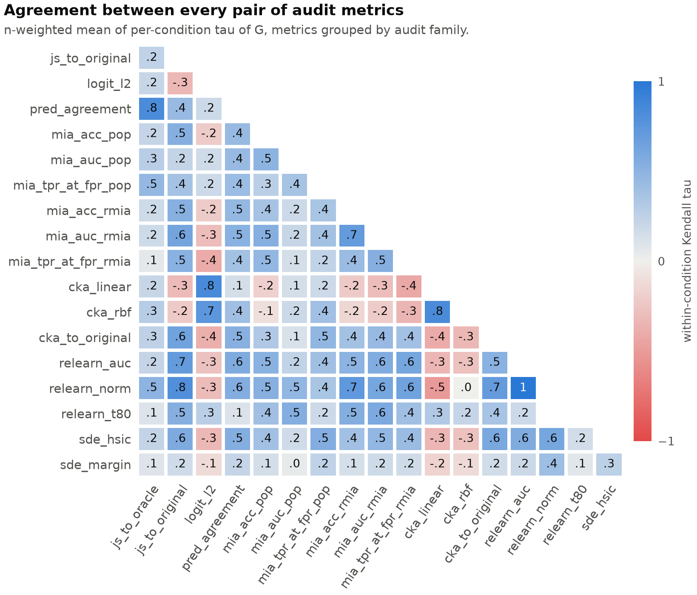

# ForgetCheck — Results

This document gives the final results of the whole study, stage by stage, with the reasoning
behind every number. It is written for the four of us, to come back to whenever a result needs
checking, explaining or defending.

| | |
|---|---|
| **Data** | The final Kaggle bundle of 11 Oct 2026 (`forgetcheck_stage8_results (3).zip`): Stage 7's calibration tables, Stage 8's analysis tables, and the figures |
| **Code** | `main` at the time of writing. The last re-audit ran at commit `ef0d8cc`. The analysis recomputes exactly from the bundle's own tables: 17 of 17 identical |
| **Where numbers come from** | Every number traces to a table under `results/calibration/` or `results/analysis/`; [Appendix C](#appendix-c--where-each-table-comes-from) says which. Nothing here was typed in from a printout. |
| **The build diary** | [`STATUS.md`](STATUS.md) records every decision, defect and correction, with its date. This document reports the *final* state; STATUS is where to look for *how* we got there. |

**How to read it.**
- **Part 1** is the summary: one page with every answer.
- **Part 2** explains the ideas the rest depends on: the three kinds of model, calibration, the
  gap *G* and the canary. Read it once.
- **Part 3** goes stage by stage, from data to analysis.
- **Parts 4–6** cover limitations, corrections made along the way, and how to reproduce
  everything.

---

## Contents

- [Part 1 — Summary](#part-1--summary)
- [Part 2 — Key ideas](#part-2--key-ideas)
- [Part 3 — Stage by stage](#part-3--stage-by-stage)
  - [Stage 0 — Environment and data](#stage-0--environment-and-data)
  - [Stage 1 — The registry](#stage-1--the-registry)
  - [Stage 2 — Forget sets](#stage-2--forget-sets)
  - [Stage 3 — Original models and retrains](#stage-3--original-models-and-retrains)
  - [Stage 4 — Unlearning methods and RMIA reference models](#stage-4--unlearning-methods-and-rmia-reference-models)
  - [Stage 5 — The pilot and the 240 unlearning runs](#stage-5--the-pilot-and-the-240-unlearning-runs)
  - [Stage 6 — The audits](#stage-6--the-audits)
  - [Stage 7 — Calibration and audit validity](#stage-7--calibration-and-audit-validity)
  - [Stage 8 — The analysis](#stage-8--the-analysis)
- [Part 4 — Limitations](#part-4--limitations)
- [Part 5 — Corrections that change how a result reads](#part-5--corrections-that-change-how-a-result-reads)
- [Part 6 — Reproducing the numbers](#part-6--reproducing-the-numbers)
- [Appendix A — Full per-method tables](#appendix-a--full-per-method-tables)
- [Appendix B — The metric registry](#appendix-b--the-metric-registry)
- [Appendix C — Where each table comes from](#appendix-c--where-each-table-comes-from)

---

## Part 1 — Summary

### The question

Machine unlearning tries to make a trained model *forget* part of its training data, the
**forget set**, without paying for retraining from scratch. Unlearning is easy to attempt and
hard to check. People check it with different kinds of **audit**:
- does the model still *behave* as if it saw the data;
- can a *membership-inference attack* tell the data was used;
- are its internal *representations* still the original's;
- can it *relearn* the data suspiciously fast?

ForgetCheck asks three things:
1. Do these audits **agree** about whether forgetting worked?
2. When they disagree, **which one is right**?
3. Does the answer depend on **how hard the deletion request is**?

The ground truth for "forgotten" is a model **retrained from scratch without the forget set**.

The setup:
- CIFAR-10, ResNet-18.
- Five unlearning methods plus one deliberately destructive control.
- Eight forget sets of controlled difficulty, five seeds.
- 240 unlearned models, 52 retrains, 10 original models and 32 attack reference models.

### The short answer

1. **No method produces a model that looks like a retrain, on any calibrated audit.**
   - Representation and relearning flag every healthy unlearned model as "unlike every
     retrain", wherever they can measure anything.
   - Behaviour flags every one too, except at mem-low (77%).
   - The privacy audits flag 84–100%, except at mem-med (52–60%).
   - Representations end up **farther from a retrain than the original model was**, at most
     conditions.
2. **The audits disagree about *which* method forgot best.** SalUn and NegGrad+ look the most
   retrain-like to the strong privacy attack (RMIA) and to relearning, and the *least*
   retrain-like to behaviour and representation.
3. **An audit's own decision rule cannot be trusted on realistic forget sets.**
   - Applied to genuine retrains, which by definition never saw the data, the population attack's
     rule calls 17 of 17 retrains "leaking" on the hardest forget set.
   - The rule the plan named as the headline privacy number (TPR at 1% FPR, population attack) is
     valid at *no* condition.
   - Calibrated against retrains instead, every audit's false-positive rate falls to the nominal
     level: 2.4% and 4.2%, against a nominal 2.3–4.6%.
4. **"Unlike a retrain" is not "remembers".** A destroyed model is also unlike a retrain. Read
   with a utility guard, 23 of the 39 audit readings score a perfect 1.00 on the ground-truth
   canary condition, 19 of them only because of the guard.
5. **Representation proximity to the original predicts relearning (H3), and audits agree most
   where memorization is strongest.** That is the opposite of the disagreement hypothesis H4.

### Answers, question by question

| | Question | Answer | Key evidence | Where |
|---|---|---|---|---|
| **RQ1** | How closely do methods reproduce a retrain? | **Not closely, on any audit.** Most models sit between a retrain and the original (G 0.3–1); on representation, most go *beyond* the original (G > 1). | 100% flagged on representation and relearning, and on behaviour except mem-low (77%); representation G > 1 for 88–100% at mem-med and the random sets | [RQ1](#rq1--how-close-to-a-retrain) |
| **RQ2 / H2a** | Do behaviour and membership inference agree? | **Partly, and only where memorization is high.** H2a ("not always identical") is supported. | Within-condition τ +0.28 (population) / +0.18 (RMIA); +0.74 / +0.75 at mem-high; −0.36 behaviour vs RMIA at mem-med | [RQ2](#rq2--h2a--behaviour-vs-membership-inference) |
| **H2b** | Do the two attacks agree, and is the population attack more lenient? | **They rank differently (supported); "more lenient" is not supported.** | τ +0.21 within; −0.30 at mem-med. Verdicts 20 vs 10, McNemar p = 0.099. On G the population attack is slightly *stricter* | [H2b](#h2b--population-attack-vs-rmia) |
| **RQ3 / H1** | Can a behaviourally retrain-like model stay internally like the original? | **Yes.** H1's replication holds; its "larger at high memorization" prediction does not. | 12 of 21 behaviourally retrain-like models are representationally original-like | [RQ3](#rq3--h1--retrain-like-outside-original-like-inside) |
| **RQ4** | Does relearning reveal what other audits miss? | **Yes, concentrated in SalUn**; elsewhere relearning mostly repeats plain accuracy. | Of 60 models RMIA calls retrain-like, 38 relearn like the original (SalUn: 25 of 28) | [RQ4](#rq4--does-relearning-see-what-privacy-misses) |
| **H3** | Do models whose representations stay closer to the original relearn faster? | **Yes, and not because of which method made them.** | Within-condition τ +0.64; slope +0.49 [0.42, 0.57] controlling for method and condition | [H3](#h3--representation-and-relearning) |
| **RQ5 / H4** | Do methods differ more, and audits disagree more, at high memorization? | **Methods differ by forget set, but not in H4's order; audits agree *most* at high memorization.** | Interaction p ≤ 0.002 for every audit; mean agreement τ +0.38 mem-high, +0.36 canary, +0.01 mem-med | [RQ5](#rq5--h4--does-difficulty-change-the-picture) |
| **RQ6 / H5** | Which audit families give correct verdicts? | **Calibrated, nearly all; by their own rules, few. H5 is supported.** | Native rules flag up to 17/17 retrains; calibrated FPR 2.4% / 4.2%; 23 of 39 canary readings at 1.00 with the guard; RMIA tracks canary memory best (τ +0.75) | [Stage 7](#stage-7--calibration-and-audit-validity), [RQ6](#rq6-by-degree--which-audits-track-how-much-a-model-remembers) |

### Five things to remember

1. **Calibrate every audit against genuine retrains, never against a fixed threshold.** A
   forget set chosen by memorization or mislabelling is a *different distribution* from test
   data. An attacker separates it whether or not the model ever saw it.
2. **Always read a forgetting verdict next to utility.** The destroyed control looks private to
   the retrain-free audits while being useless (10% accuracy): population AUC 0.49–0.53
   everywhere, "no leakage". Where their own rules do flag it, it is for the wrong reason, as
   Stage 6 explains.
3. **"Lower forget accuracy" is not better forgetting.** The naive ranking puts the destroyed
   model first; measured against retrains, it is last.
4. **Methods trade one audit against another.** No single audit can rank unlearning methods.
5. **Strong attacks and original-referenced measures track memory best.** On the canary, where
   the truth is known, RMIA (+0.75) and the two "distance from the original" measures (+0.68,
   +0.55) follow how much a model remembers most closely.

---

## Part 2 — Key ideas

### 2.1 Three kinds of model, plus a control

| name | what it is | role |
|---|---|---|
| **M0**, the original | ResNet-18 trained on all 50,000 CIFAR-10 training images | Remembers the forget set by construction: the **positive control** |
| **Retrain** (oracle) | ResNet-18 trained from scratch on everything *except* the forget set | Never saw the forget set: the **reference**. "Forgotten" means "looks like a retrain" |
| **Unlearned model** | M0 after an unlearning method has been applied | What is being audited |
| **NegGrad**, the destroyed control | M0 after unbounded gradient ascent on the forget set | Wrecked on purpose (10% accuracy, a constant predictor). Shows that "looks forgotten" can mean "broken" |

Retrains differ from each other because training is random, so a single retrain is not "the"
answer. We use a **band** of retrains:
- 5 per condition, each sharing a random seed with one M0 ("paired");
- plus 12 independent ones at the primary condition.

### 2.2 The eight forget sets

| condition | how chosen | size | role |
|---|---|---:|---|
| `mem-high-3000` | the 3,000 most-memorized examples | 3000 | **Primary**: where the original and a retrain genuinely differ |
| `mem-med-3000` | the 3,000 with memorization nearest 0.5 | 3000 | Middle of the difficulty axis |
| `mem-low-3000` | the 3,000 least-memorized examples (all exactly 0) | 3000 | **Negative control**: the original and a retrain should be the same here |
| `rand-500/2500/3000/5000` | uniform random, nested (500 ⊂ 2500 ⊂ 3000 ⊂ 5000) | 500–5000 | Size axis; `rand-3000` bridges the two axes |
| `canary-500` | 500 random examples given a deliberately **wrong label** before M0 trained | 500 | **Ground truth**: only memorization can fit a wrong label, so residual memory is measurable directly |

"Memorization" is the Feldman–Zhang score released by the RUM paper. It is the drop in a model's
accuracy on an example when that example is left out of training.

### 2.3 What "forgotten" means

A retrain still classifies most forget-set examples correctly, because it learned "cat" from
other cats. So the goal is not "be wrong on the forget set"; it is "**behave like a model that
never saw it**". The pilot made this concrete at mem-high, on forget-set accuracy (final data;
retrain 0.559, M0 ≈ 1.00):

| | naive ranking ("lower forget accuracy is better") | ranked by distance from a retrain (G) |
|---|---|---|
| 1 | **NegGrad, destroyed (0.078)** | NegGrad+ (G 0.38) |
| 2 | NegGrad+ (0.726) | SalUn (0.61) |
| 3 | SalUn (0.828) | L1-sparse (0.77) |
| 4 | L1-sparse (0.898) | SCRUB (0.83) |
| 5 | SCRUB (0.926) | Fine-tune (0.89) |
| 6 | Fine-tune (0.950) | **NegGrad, destroyed (1.09)** |

The naive metric ranks the destroyed model **first**; measured against retrains it is **last**.
This is why every metric in the registry declares its direction in advance. Forget accuracy is
"closer to the retrain is better", not "lower is better".

### 2.4 The audit families

| family | primary metric | what it measures | "forgotten" looks like |
|---|---|---|---|
| **Behaviour** | `js_to_oracle` | Jensen–Shannon divergence between the model's predicted class probabilities and the retrains', on the forget set | small, like retrain-to-retrain |
| **Privacy, weak** (population MIA) | `mia_auc_pop` | AUC of one attacker trained to tell forget examples from test examples by loss, confidence and entropy | like the retrains' AUC (*not* 0.5; see 2.5) |
| **Privacy, strong** (RMIA) | `mia_auc_rmia` | AUC of a per-example attack comparing the model's confidence with 32 reference models trained on random halves of the data | like the retrains' AUC |
| **Representation** | `cka_linear` at `layer4` | Linear CKA (similarity of internal activations, 0–1) between the model and the retrains on 3,000 probe images | like retrain-to-retrain similarity |
| **Reversibility** (relearning) | `relearn_auc` | Average forget-set accuracy while fine-tuning on 500 reintroduced forget examples, over 100 steps | like a retrain's curve |
| **Independence** (SDE) | `sde_hsic`, `sde_margin` | A recent retrain-free test (ICLR 2026): are a subset's outputs statistically "co-trained"? | secondary, unranked |

Each family has further metrics: `pred_agreement`, `logit_l2`, accuracy and TPR at 1% FPR for
each attack, RBF-CKA, `relearn_t80` and others; [Appendix B](#appendix-b--the-metric-registry)
lists all 37. Two more measure **closeness to the original** rather than to the retrains:
- `js_to_original` (behaviour);
- `cka_to_original` (representation, added for H3).

### 2.5 Calibration: native rules vs retrain bands

Every audit can give a pass/fail verdict two ways.

- **The native rule** is the audit as practitioners use it, with no retrains involved. For a
  membership attack, "AUC significantly above 0.5 means the data leaks". For SDE, its own sign
  rule.
- **The calibrated verdict** asks whether the model is outside the **retrain band**, the range
  genuine retrains occupy on that metric at that condition. The band is a 95.45% prediction
  interval, mean ± t·s·√(1 + 1/n), which works with as few as five retrains. It is one-sided
  for metrics with a direction and two-sided for "closer to the retrain".

Two properties of an audit follow:
- **False-positive rate (FPR):** the share of genuine retrains it flags. A retrain *cannot* have
  failed to forget, so any flag on one is an error in the audit. For calibrated verdicts this is
  measured leave-one-out: each retrain against a band built from the others.
- **Power:** the share of M0s it flags. M0 trained on the forget set, so an audit that cannot
  flag it cannot see anything at that condition.

A membership attack's "correct" AUC for a forgotten model is therefore **the retrains' AUC, not
0.5**. Retrains score well above 0.5 on atypical forget sets: 0.84 at mem-high, 0.995 at the
canary. That one fact drives much of Stage 7.

### 2.6 The normalized oracle gap, *G*

To compare audits on one scale, every metric value *m* of an unlearned model becomes

> **G = |m(model) − mean m(retrains)| / |m(M0) − mean m(retrains)|**

- **G = 0**: exactly like the average retrain. **G = 1**: as far from the retrains as M0 is,
  i.e. no forgetting on this metric.
- **G > 1**: farther from the retrains than M0. Unlearning moved the model *away* from
  retraining, past where it started.
- *Worked example.* At mem-high, the retrains' forget accuracy is 0.559 and M0's ≈ 1.00. A model
  at 0.828 has G = (0.828 − 0.559) / (1.00 − 0.559) = 0.61: 61% of M0's distance from the
  retrains is left.

Three variants are used:
- **Signed G** = (m − retrain mean) / (M0 − retrain mean). The same, but negative when a model
  sits on the *opposite* side of the retrains from M0. Used for H3, whose hypothesis has a
  direction.
- **log G** is used in the regression models. M0's gap is a constant within a condition, so on
  the log scale it is absorbed by the condition term, and each method's coefficient becomes a
  clean ratio ("×2 = twice as far from the retrains as fine-tune").
- **Medians**, because G's right tail is long wherever M0 is barely different from a retrain
  (dividing by almost nothing).

### 2.7 Three safeguards

1. **Marked cells: no score where nothing can be seen.** A (metric, condition) cell is *marked*,
   and left out of every statistic, when M0 itself is indistinguishable from the retrains:
   - M0 within one retrain standard deviation (low discriminability); or
   - for proportion metrics, M0 within **2 points** of the retrain mean.

   The second rule catches ceilings. At mem-low the retrains relearn to 0.998, so a 0.002 gap reads
   as "4.2 sd" but means nothing. 30 of the analysed metric-condition cells are marked.
2. **The damage guard.** A model whose test accuracy is more than **5 points** below the retrain
   mean is *damaged*. A flag on it is read as damage, not memory.
   - 43 models are damaged: all 40 NegGrad, plus 3 at mem-low (two NegGrad+, one SCRUB, hurt by
     gradient ascent on easy examples).
   - Outside mem-low, healthy methods lose at most 3.8 points; NegGrad loses 83.5–85.6.
   - At mem-low, healthy models lose up to 4.6, and the nearest damaged one 5.02. So only
     thresholds from 4.6 to 5.0 classify every model the same way. The 5 points was not tuned to
     the data: it is the number registered earlier for the relearning guard.
   - The choice touches nothing else: at mem-low only behaviour is scored, and re-including the
     three damaged mem-low models changes no registered statistic.
3. **A retired metric.** `activation_l2` (raw activation distance) turned out to measure the
   shared random initialisation, not forgetting. It is kept in the records and excluded from
   every verdict ([Stage 7](#76-shared-initialisation-and-the-retirement-of-activation_l2)).

### 2.8 The canary ground truth

M0 trained with 500 deliberately mislabelled images. A retrain never saw them, so it has no
reason to prefer the wrong label. Any unlearned model that still does is remembering, **by
construction**.

The measure is `canary_top_wrong`: among the nine *wrong* labels only, how often the assigned
wrong label is the model's favourite.
- A model with no memory picks it about 1 time in 9: retrains score 0.128.
- M0 scores 0.710.
- An unlearned model "still remembers" if it is above the retrain band (upper edge 0.137).

The plan's original measures, `canary_acc` and `canary_prob`, mis-score the destroyed model,
which hits the wrong label 1 time in 10 by chance. `canary_top_wrong` was added and approved for
that reason.

### 2.9 The statistics, briefly

- **Kendall's τ** (tau) measures how often two audits put pairs of models in the same order:
  +1 the same order, 0 unrelated, −1 reversed. **Spearman's ρ** (rho) is the rank correlation.
- **The unit is the model**, not the method. A rank correlation over a handful of methods has
  almost no power:
  - with 4 methods even perfect agreement gives p = 0.083;
  - with 5, only perfect agreement reaches p < 0.05.

  So we correlate across all 197 healthy models (25 per condition).
- **95% bootstrap intervals** come from 10,000 resamples of models, seed 300.
- **Pooled vs within.**
  - *Pooled* correlates all conditions at once.
  - *Within* is the average of the per-condition correlations, weighted by n. It is the cleaner
    read, because pooling can manufacture agreement when every audit just shifts with the
    condition.
- **Mixed-effects models** (`log G ~ method + condition + (1 | seed)`) are the confirmatory
  tests. Reference method: fine-tune; reference condition: rand-3000.
- **Registered vs exploratory.** The registered analyses are §15.2 correlations, §15.3 pass/fail
  disagreement, §16.2 mixed models and §15.1 rank tables. Anything added after seeing data is
  labelled **exploratory**: signed G, the share beyond M0, canary validity by degree, RQ4 on G,
  the McNemar test, agreement by condition, and H3's controlled model.

### 2.10 Glossary

| term | meaning |
|---|---|
| forget set / retain set | the examples to be forgotten / everything else in the training set |
| M0 | the original model, trained on everything |
| retrain, oracle | a model trained from scratch without the forget set |
| paired retrain | the retrain that shares M0's random seed (and so its initial weights) |
| band | the range genuine retrains occupy on a metric (95.45% prediction interval) |
| flagged | outside the band: "unlike every retrain" |
| native rule | an audit's own pass/fail rule, without retrains |
| FPR / power | share of retrains flagged (should be ≈ nominal) / share of M0s flagged (should be high) |
| G, signed G | distance from the retrains as a fraction of M0's distance (2.6) |
| marked | a cell where M0 cannot be told from a retrain; not scored (2.7) |
| damaged | test accuracy > 5 points below the retrains (2.7) |
| MIA, population attack, RMIA | membership-inference attack; one attacker for all examples; per-example attack with reference models |
| AUC, TPR@1% FPR | area under the ROC curve; the share of members caught when only 1% of non-members are wrongly accused |
| CKA | centered kernel alignment: similarity of two networks' internal activations, 0–1 |
| relearn AUC, T80 | average forget accuracy during relearning; steps to recover 80% of M0's accuracy |
| SDE | split-half dependence evaluation (ICLR 2026), a retrain-free audit based on HSIC |
| τ, ρ | Kendall's and Spearman's rank correlations |
| canary | a training image given a deliberately wrong label |

---

## Part 3 — Stage by stage

The stages are the implementation plan's build stages, each with a gate that had to pass before
the next began. (The CLI's `queue --stage N` numbers are different: queue stage 4 is the RMIA
reference models, which this document covers under Stage 4.)

| stage | what it produced | gate |
|---|---|---|
| 0 | data and environment | ✅ data hash pinned |
| 1 | the record and metric registry | ✅ |
| 2 | the eight forget sets | ✅ verified against the real memorization scores |
| 3 | 10 original models, 52 retrains | ✅ seed spread within tolerance |
| 4 | six unlearning methods; 32 RMIA reference models | ✅ |
| 5 | 240 unlearned models | ✅ every run from the final implementations |
| 6 | six audits over every model; 9,238 audit records | ✅ |
| 7 | calibration and audit validity | ✅ every audit has a retrain FPR and a canary accuracy |
| 8 | the agreement analysis, 7 figures | ✅ reproduced exactly from the tables |

---

### Stage 0 — Environment and data

**What was done.**
- **CIFAR-10:** 50,000 training and 10,000 test images, exactly 5,000 per class in training. It
  is hashed (`6b3883dca6c867f1`) and the hash is pinned in `configs/base.yaml`, so a corrupt or
  different download on any machine fails loudly instead of silently changing every result.
- **Memorization scores:** the 50,000-element Feldman–Zhang estimate released with the RUM paper
  (sha `2875af6972b5af57`). Feldman and Zhang's own release covers CIFAR-100 and ImageNet only,
  so RUM is the one source for CIFAR-10.
- **Compute:**
  - Training ran on Kaggle GPUs (T4/P100) across three accounts.
  - The team's laptop cannot train on its integrated GPU, and on CPU a 30-epoch run takes
    4.76 hours.
  - Audits needing forward passes ran on Kaggle too; calibration and analysis run anywhere.

**Why it matters.** Every later comparison is between models that must have seen *exactly* the
same data. The hash is what makes "same data" a checked fact rather than an assumption.

---

### Stage 1 — The registry

**What was done.** Three contracts were fixed before any model existed:
- **Records.** Every measurement is one row: model, audit, metric, probe set, value, plus
  provenance (git commit, environment, checkpoint hash, timestamp).
  - Rows are written as append-only Parquet files, one per model and audit, and validated on
    write.
  - An undefined value, such as an AUC over a constant predictor, is never written as NaN. It is
    recorded as an `audit_undefined` count with the metric named, so "could not measure" stays
    distinguishable from "never ran".
- **Run identifiers.** `c10r18__{role}__{condition}__{method}__{seed}`, derivable from the
  configuration alone. Four people on three Kaggle accounts could split the work without
  colliding.
- **The metric registry** (`configs/metrics.yaml`): 37 metrics in seven families, each with a
  *direction* declared before any result existed.
  - The three directions are `higher_better`, `lower_better` and `closer_to_oracle`.
  - New metrics need the four-person sign-off. Two were added during the build:
    `canary_top_wrong` and `cka_to_original`.
  - One, `activation_l2`, was retired with a stated reason.

**Why it matters.** Declaring direction in advance prevents choosing the flattering reading after
seeing the numbers. The validator caught a real case early: a loss metric was about to be
recorded on the forget set under the direction "lower is better". There, a low loss means the
model still fits the data it should have forgotten, so the models remembering most would have
ranked as the best forgetters. The forget set now has its own loss metric, declared "closer to the
retrain is better", the distinction Part 2.3 shows matters.

---

### Stage 2 — Forget sets

**What was done.** The eight conditions of Part 2.2 were built as deterministic, hashed index
arrays. Regenerating one on another machine gives byte-identical indices, or fails.

**The memorization strata**, measured on the real scores:

| stratum | mean memorization | sd | range |
|---|---:|---:|---|
| mem-low (3,000 lowest) | 0.0000 | 0.0000 | exactly 0 for all 3,000 |
| mem-med (3,000 nearest 0.5) | 0.5004 | 0.0345 | 0.44–0.56 |
| mem-high (3,000 highest) | 0.9655 | 0.0270 | 0.915–1.000 |

The strata do not overlap.

**What the scores say about CIFAR-10 itself.** Memorization is far from rare:
- 26.6% of training images score below 0.01;
- 48.5% score between 0.01 and 0.5;
- **24.9% score above 0.5** (mean 0.279, median 0.133).

So a random 3,000-image forget set is a *mixture*, not an easy case: mean memorization 0.276, with
731 of its 3,000 images as memorized as the mem-high stratum. The random conditions therefore carry
real signal, diluted. An early claim that random sets are "overwhelmingly low-memorization" was
wrong and was corrected once the real scores arrived.

**Design decisions with consequences:**
- **mem-low is an exact negative control.** Every one of its 3,000 images has memorization 0.0,
  so theory predicts the original and a retrain behave *identically* there. An audit that reports
  a strong effect at mem-low is misbehaving.
- **mem-med follows RUM's definition**: the 3,000 nearest 0.5 on the *score* scale, not the
  middle of the ranking. On this bottom-heavy distribution the rank-middle sits near zero and
  would have collapsed onto mem-low.
- **The canary labels** are assigned as `(true label + 1 + index mod 9) mod 10`. The offset is
  always 1–9, so the assigned label can never equal the true one.
  - Canaries are drawn from their own random stream: their overlap with rand-500 is 3 of 500,
    which is chance.
  - An earlier shared stream had made the two conditions *identical*, which was caught and fixed.
- **The size axis is nested**: rand-500 ⊂ rand-2500 ⊂ rand-3000 ⊂ rand-5000. A difference
  between sizes is then due to size, not to which images were drawn. The cost is that the size
  conditions are not independent samples.

---

### Stage 3 — Original models and retrains

**What was trained.** 62 ResNet-18s, about 460 seconds each on a T4, roughly 8 GPU-hours:
- **10 original models (M0):** 5 seeds on the clean data, 5 on the canary-corrupted data.
- **40 paired retrains:** 5 seeds × 8 conditions, each sharing its seed with an M0.
- **12 independent retrains** at mem-high (seeds 200–211). Seeds 209–211 were held out of the
  band, as a pre-registered check of the band itself.

Every model used the same schedule:
- the CIFAR variant of ResNet-18 (3×3 first convolution, no max-pool);
- 30 epochs of SGD (lr 0.1, Nesterov momentum 0.9, weight decay 5×10⁻⁴), batch 256;
- a cosine schedule with one warm-up epoch, mixed precision.

The schedule must be identical for M0, the retrains and the reference models, or every
retrain-referenced comparison becomes a comparison of training recipes.

**Results.**

| model | test accuracy (mean ± sd over seeds) |
|---|---|
| M0, clean data | 0.9348 ± 0.0017 |
| M0, with the 500 mislabelled canaries | 0.9284 ± 0.0012 |

The 500 wrong labels cost M0 about 0.6 points of test accuracy.

Retrains, per condition:

| condition | n | test acc (mean ± sd) | forget acc (mean ± sd) |
|---|---:|---:|---:|
| canary | 5 | 0.9346 ± 0.0017 | 0.014 on the canary labels (0.935 on the true ones) |
| mem-high | 17 | 0.9231 ± 0.0022 | 0.559 ± 0.006 |
| mem-med | 5 | 0.9305 ± 0.0009 | 0.909 ± 0.002 |
| mem-low | 5 | 0.9348 ± 0.0020 | 0.998 ± 0.001 |
| rand-500 | 5 | 0.9336 ± 0.0027 | 0.934 ± 0.008 |
| rand-2500 | 5 | 0.9327 ± 0.0017 | 0.931 ± 0.002 |
| rand-3000 | 5 | 0.9324 ± 0.0014 | 0.934 ± 0.003 |
| rand-5000 | 5 | 0.9310 ± 0.0010 | 0.932 ± 0.001 |

**What this shows.**
1. **The difficulty axis is real.** A retrain that never saw the forget set still gets 99.8% of
   mem-low right, about 93% of a random set, 91% of mem-med, and only **56% of mem-high**. M0,
   which trained on them, gets ≈ 100% of each. So M0 and a retrain genuinely differ at mem-high
   and barely at all at mem-low, exactly as the design intended.
2. **Hard examples help generalisation.** Leaving out the 3,000 most-memorized images costs the
   retrain 1.2 points of test accuracy (0.9231 vs 0.9348). Leaving out the 3,000 least-memorized
   costs nothing, and a random 3,000 about 0.2. Memorized examples are not just noise.
3. **56% is far above the ~3% the scores alone would suggest.** This is expected: Feldman–Zhang
   estimated memorization from models trained on 70% subsets, while our retrains see 94% of the
   data. A reviewer doing the naive arithmetic needs to be told.
4. **Seed reproducibility passes.**
   - Test-accuracy sd across the 17 mem-high retrains is 0.22 points, against a 0.4-point
     tolerance.
   - The gate was first written as a *range*, which grows with the number of models: the same
     models "passed" with 6 and "failed" with 12. It was respecified as a standard deviation.
5. **A first warning about naive bands.** On test accuracy, one held-out retrain (seed 211)
   fell outside the 2-standard-deviation band built from the nine band-forming retrains. That is a false positive on a model that
   cannot have failed to forget. It is why Stage 7 uses prediction intervals instead.

**Runs are not bit-reproducible across GPU sessions.** Kaggle allocates T4 or P100, and cuDNN
autotuning is left on for speed. The same configuration and seed can differ by up to 0.9 points
of forget accuracy. So the five-seed spread is *seed plus hardware* variance, and the stored
checkpoints, not the configurations, are the reproducible artefacts. Retrains carry the same noise,
so comparisons stay fair.

---

### Stage 4 — Unlearning methods and RMIA reference models

**The six methods.** All follow one interface, use one shared training loop, and have their
configuration hashed into the checkpoint, so a changed method can never silently reuse an old
result.

| method | mechanism | final settings | departures from the published method |
|---|---|---|---|
| **Fine-tune** | Keep training M0 on the retain set only | 5 epochs, SGD lr 0.01, momentum 0.9, wd 5×10⁻⁴ | — |
| **NegGrad** (destructive control) | Gradient *ascent* on the forget set, no retain term | 60 steps, lr 0.01 | Budget in **steps**, not epochs, so it is equally destructive at every size |
| **NegGrad+** | Ascent on the forget set while descending on the retain set | 5 epochs, lr 0.01, retain weight α = 0.95 | Forget term **capped at chance-level loss** (ln 10 = 2.303) |
| **SCRUB** | Teacher–student: stay close to M0 on retain, move away on forget | 5 epochs (2 with ascent), lr 0.005, temperature 4 | Ascent capped at **24 steps** in total |
| **SalUn** | Mask the 50% of weights most salient to the forget set; fine-tune the forget set on *random* labels through that mask, plus the retain set | 5 epochs, lr 0.01 | — (an early implementation under-sampled the retain set; fixed to match the authors' code) |
| **L1-sparse** | Fine-tune on the retain set with an L1 penalty that sparsifies the weights | 5 epochs, lr 0.01, λ = 5×10⁻⁵ | — |

SSD (selective synaptic dampening) is implemented but was not run. Its mechanism cannot separate a
random forget set from the retain set, which is why the review removed it from the core set.

**The two deliberate deviations, and why.**
- **NegGrad+'s cap.** The published loss rewards ascent forever, and in the pilot it destroyed the
  model (test accuracy 0.33).
  - Capping the forget loss at the loss of a uniform guess has the *same* gradient while the
    model still knows the forget set, and zero gradient once it does not.
  - Past chance level a model is not forgetting any more, it is becoming confidently wrong, which
    is the distinction this project is built on. Setting the cap to infinity recovers the
    published loss.
- **SCRUB's cap.** Its ascent phase is also unbounded, and its budget grew with forget-set size.
  At rand-5000, retain accuracy fell to 0.55–0.83. 24 steps is *exactly* the published schedule
  at the 3,000-image conditions; only the other sizes change.

**A confound found and removed.** Three methods originally counted their budget in passes over the
forget set, so they received 10× more updates at rand-5000 than at rand-500. Any "size effect"
would partly have been a compute effect. All ascent budgets are now fixed in steps.

**RMIA reference models** (the plan's "shadow models"; queue stage 4):
- 32 ResNet-18s, each trained with the Stage 3 schedule on a random half of the 50,000 training
  images (drawn with the audit seed, 300).
- Every training image is therefore *absent* from about 16 of them.
- They model the data distribution, not any forget set, so the same 32 serve all eight conditions.

---

### Stage 5 — The pilot and the 240 unlearning runs

**The pilot did its job.** One seed, mem-high only, all six methods, run end to end before the full
matrix. It found two misconfigurations that would have been invisible in averages:
1. **The destructive control was not destructive.** Twelve tiny steps left it untouched.
2. **NegGrad+ diverged** into a collapsed model (hence the cap above).

The first full run found two more, both from budgets that scaled with forget-set size:
- NegGrad was a no-op again at rand-500, and SCRUB diverged at rand-5000.
- SalUn collapsed at the *small* forget sets. It paired one retain batch with each forget batch,
  under-sampling the retain set 97× at rand-500. Damage running *backwards* in size was the tell.

All were fixed, 64 runs were recomputed, and **every one of the 240 final models comes from the
final implementation of its method**. One check confirmed it: an account that re-ran SalUn after
the fix agreed with the accounts that never had the bug, within seed noise.

**Two early results that must not be quoted** (both changed by the fixes):
- **"SalUn forgets far better than the rest" was an artefact.** The under-sampled version bought
  its forgetting with 4.5 points of test accuracy. The faithful version forgets less and keeps the
  retrain's test accuracy.
- **SCRUB's canary forgetting was badly understated.** Under the old schedule it kept the planted
  label for 31–34% of canaries, far above every other method. That was the size confound: at 500
  examples the schedule gave it a sixth of its usual ascent. With the budget fixed it keeps 19%.
  That is still the most of the healthy methods, but close to NegGrad+ and fine-tune.

**The final 240 models (6 methods × 8 conditions × 5 seeds).** Forget-set accuracy, mean over
5 seeds:

| method | canary | mem-high | mem-med | mem-low | rand-500 | rand-2500 | rand-3000 | rand-5000 |
|---|---:|---:|---:|---:|---:|---:|---:|---:|
| Fine-tune | 0.170 | 0.950 | 0.987 | 1.000 | 0.988 | 0.990 | 0.990 | 0.990 |
| L1-sparse | 0.108 | 0.898 | 0.964 | 0.999 | 0.974 | 0.973 | 0.974 | 0.974 |
| NegGrad+ | 0.181 | 0.726 | 0.863 | 0.932 | 0.813 | 0.945 | 0.959 | 0.978 |
| SalUn | 0.146 | 0.828 | 0.970 | 0.999 | 0.943 | 0.972 | 0.973 | 0.962 |
| SCRUB | 0.186 | 0.926 | 0.986 | 0.995 | 0.984 | 0.997 | 0.997 | 0.997 |
| NegGrad (control) | 0.096 | 0.078 | 0.074 | 0.032 | 0.087 | 0.095 | 0.097 | 0.086 |
| **retrain** | 0.014 | 0.559 | 0.909 | 0.998 | 0.934 | 0.931 | 0.934 | 0.932 |
| **M0** | 0.386 | ≈1.00 | ≈1.00 | ≈1.00 | ≈1.00 | ≈1.00 | ≈1.00 | ≈1.00 |

(At the canary the column is accuracy on the *wrong* labels the models trained on,
`canary_acc`: how often a canary is still given its planted label.)

Test accuracy, mean over 5 seeds:

| method | canary | mem-high | mem-med | mem-low | rand-500 | rand-2500 | rand-3000 | rand-5000 |
|---|---:|---:|---:|---:|---:|---:|---:|---:|
| Fine-tune | 0.922 | 0.930 | 0.928 | 0.927 | 0.925 | 0.927 | 0.927 | 0.927 |
| L1-sparse | 0.905 | 0.920 | 0.915 | 0.915 | 0.913 | 0.914 | 0.912 | 0.914 |
| NegGrad+ | 0.927 | 0.913 | 0.903 | 0.885 | 0.920 | 0.923 | 0.925 | 0.928 |
| SalUn | 0.928 | 0.927 | 0.928 | 0.929 | 0.930 | 0.930 | 0.929 | 0.916 |
| SCRUB | 0.931 | 0.932 | 0.932 | 0.894 | 0.935 | 0.934 | 0.934 | 0.935 |
| NegGrad (control) | 0.102 | 0.107 | 0.093 | 0.103 | 0.097 | 0.100 | 0.103 | 0.091 |
| **retrain** | 0.935 | 0.923 | 0.931 | 0.935 | 0.934 | 0.933 | 0.932 | 0.931 |

**What this shows.**
1. **Every healthy method keeps utility.**
   - Mean test accuracy stays within 3 points of the retrains for every method and condition.
     The largest gaps are L1-sparse at the canary (3.0) and NegGrad+ at mem-med (2.8).
   - The exceptions are NegGrad+ and SCRUB at mem-low (5.0 and 4.1 on average). Gradient ascent
     on the *easiest* examples costs up to 7.8 points for one seed, and three of those models
     cross the 5-point damage guard.
   - mem-low is also where seeds disagree most. SCRUB's retain accuracy varies by 3.3 points
     (sd) across seeds there, against at most 0.65 at any other condition.
2. **Forgetting is partial everywhere.** At mem-high every method leaves forget accuracy between
   M0 (≈ 1.00) and the retrains (0.56).
   - NegGrad+ moves furthest (0.73) and fine-tune least (0.95).
   - In G terms on this one metric, NegGrad+ 0.38, SalUn 0.61, L1-sparse 0.77, SCRUB 0.83,
     fine-tune 0.89.
3. **On random sets the methods barely move.** Retrains get about 93%; the methods mostly stay
   at 94–99.7%, close to M0. NegGrad+ at rand-500 (0.81) is the one exception. A random forget
   set looks like the rest of the data, so there is little to undo, and the methods mostly undo
   nothing.
4. **At mem-low nothing needs forgetting.** Every model, retrain or not, is at the ceiling.
5. **The destroyed control is a constant predictor**: about 10% accuracy everywhere (one class
   for everything; macro-F1 0.019 in the pilot). It "forgets" by forgetting everything.

**The canary ground truth.** `canary_top_wrong`, mean over 5 seeds, with the range across seeds:

| model | canary_top_wrong (mean, range) | canary_acc | still remembers (of 5) |
|---|---:|---:|---:|
| **M0** | 0.710 (0.688–0.726) | 0.386 | 5 |
| **retrain** | 0.128 (0.126–0.132) | 0.014 | 0 |
| Fine-tune | 0.529 (0.496–0.566) | 0.170 | 5 |
| L1-sparse | 0.370 (0.340–0.394) | 0.108 | 5 |
| NegGrad+ | 0.555 (0.530–0.568) | 0.181 | 5 |
| SalUn | 0.470 (0.450–0.498) | 0.146 | 5 |
| SCRUB | 0.616 (0.576–0.648) | 0.186 | 5 |
| NegGrad (control) | 0.108 (0.094–0.128) | 0.096 | 0 |

- **Retrains sit close to chance among the nine wrong labels** (1/9 = 0.111), as a model with no
  memory should.
- **M0 memorized the canaries only partly.** It predicts the planted label for 39% of them.
- **Every healthy unlearned model still remembers**, all 25. Each method keeps between 42%
  (L1-sparse) and 84% (SCRUB) of M0's excess over the retrains, (value − 0.128) / (0.710 − 0.128).
- **The only model that removes the association is the one that destroys itself.** So at the
  canary, the right verdict for every healthy model is "not forgotten", and for the control
  "forgotten, by damage".

---

### Stage 6 — The audits

**What each audit computes.** Every model was run through six audits on fixed *probe sets*:
- the forget set;
- 3,000 retain images;
- 10,000 test images;
- for representation, a mixed probe of 1,000 forget + 1,000 retain + 1,000 test images. At
  rand-500 the shortfall is filled from retain and test, because CKA's value depends on the probe
  size.

| audit | how it works | metrics |
|---|---|---|
| **Behaviour** | Compares the model's predicted class probabilities with the reference retrains' (and, for `js_to_original`, with its own M0's), on forget, retain and test probes | `js_to_oracle`, `pred_agreement`, `logit_l2`, `js_to_original` |
| **Population MIA** | Trains one logistic attacker to tell forget images (members) from an equal number of test images (non-members), using the model's loss, confidence and entropy; out-of-fold over 5 splits | AUC, balanced accuracy, TPR at 1% FPR |
| **RMIA** | For each image, compares the model's confidence with the 32 reference models' (offline estimator, a = 0.3, γ = 2). Tailored per example, so much stronger | AUC, accuracy, TPR at 1% FPR |
| **Representation** | Global-average-pooled activations of ResNet layers 1–4 on the mixed probe; CKA with each reference retrain, averaged; and with the model's own M0 | `cka_linear`, `cka_rbf` (second measure), `cka_to_original` |
| **Relearning** | Fine-tunes the model on 500 forget images for 100 steps (SGD lr 0.01, batch 128) and records forget-set accuracy at steps 0, 1, 2, 5, 10, 25, 50 and 100. At the canary it relearns the *planted* labels | `relearn_auc` (area under that curve), `relearn_t80` (steps to 80% of M0's starting accuracy), `relearn_norm` |
| **SDE** | Split-half statistical dependence (HSIC) of the model's outputs on the forget set, compared with an in-training (retain) and an out-of-training (test) reference over 200 draws | `sde_hsic`, `sde_margin`, `sde_verdict` |

The relearning protocol has two built-in anchors, the paired retrain and M0, run under identical
batches, plus a random-initialisation floor once per condition. A recovery during which the model
loses more than 5 points of utility is voided.

The scale: 240 models, six audits each, **9,238 records**, plus the 52 retrains and 40 M0 runs
that Stage 7 passed through the same audits. A model costs about 45 seconds at 500 forget images
and 150–210 seconds at 3,000, mostly SDE.

**Two departures, both measured.**
- **SDE's kernel bandwidth.** The paper's √(dimension) bandwidth makes every pair of 10-class
  softmax outputs look identical (kernel ≈ 1), so HSIC collapses to about 10⁻⁷ of numerical
  noise. The median heuristic gives about 10⁻², a usable range.
- **RMIA uses its offline estimator for members and non-members alike.** The reference models are
  drawn from the training pool: a forget image is "in" about 16 of them, but a test image is in
  none. Mixing estimators would have built the member/non-member difference into the attack.

**The first result, visible from the very first condition: the retrain-free audits cannot
recognise a destroyed model, and every retrain-referenced audit rejects it.** At mem-high (5-seed
means; the retrain row is the band's mean):

| model | js_to_oracle | pred_agreement | mia_auc_pop | mia_auc_rmia | cka_linear | cka_to_original | relearn_auc | sde_margin |
|---|---:|---:|---:|---:|---:|---:|---:|---:|
| Fine-tune | 0.221 | 0.590 | 0.724 | 0.843 | 0.868 | 0.977 | 0.927 | 0.034 |
| L1-sparse | 0.199 | 0.605 | 0.742 | 0.782 | 0.872 | 0.952 | 0.841 | 0.031 |
| NegGrad+ | 0.189 | 0.624 | 0.767 | 0.619 | 0.795 | 0.816 | 0.681 | 0.014 |
| SalUn | 0.150 | 0.639 | 0.839 | 0.596 | 0.863 | 0.912 | 0.835 | -0.009 |
| SCRUB | 0.196 | 0.609 | 0.754 | 0.819 | 0.887 | 0.971 | 0.866 | 0.043 |
| NegGrad (control) | 0.622 | 0.084 | 0.510 | 0.595 | 0.086 | 0.070 | 0.083 | -0.002 |
| **retrain** (band mean) | 0.087 | 0.760 | 0.844 | 0.400 | 0.933 | 0.861 | 0.575 | 0.000 |
| **M0** | 0.245 | 0.567 | 0.733 | 0.890 | 0.861 | 1.000 | 0.985 | 0.031 |

- **The constant predictor looks private to the retrain-free audits.** Its population AUC is
  0.49–0.53 at every condition: "no leakage". Its SDE margin is about 0, so SDE's verdict is a coin
  flip (1–3 of 5 seeds flagged per condition).
- **Where their own rules do flag it, it is for the wrong reason.**
  - RMIA's rule flags it at mem-high (AUC 0.595) and the canary (0.896). A constant predictor
    gives every image the same probability, so its RMIA score comes entirely from the reference
    models. That is an artefact of the attack, not memory (explained under the canary table
    below).
  - The population rule flags it at mem-low and mem-med, where it also flags every genuine retrain
    (Stage 7.1).
- **Compared against the retrains, it is rejected outright.** Its JS divergence is 0.62, against
  a maximum possible of ln 2 = 0.69, and its CKA is 0.09.
- **The retrains' population AUC is 0.844, *higher* than M0's 0.733.** The attack reads models
  that never saw the forget set as *more* member-like than the one that did. Stage 7 explains why.

At the canary the same pattern appears, with the label scheme exaggerating it:

| model | js_to_oracle | pred_agreement | mia_auc_pop | mia_auc_rmia | cka_linear | cka_to_original | relearn_auc | sde_margin |
|---|---:|---:|---:|---:|---:|---:|---:|---:|
| Fine-tune | 0.134 | 0.758 | 0.947 | 0.203 | 0.867 | 0.936 | 0.603 | -0.025 |
| L1-sparse | 0.121 | 0.784 | 0.959 | 0.136 | 0.876 | 0.859 | 0.499 | -0.008 |
| NegGrad+ | 0.141 | 0.749 | 0.945 | 0.218 | 0.863 | 0.945 | 0.612 | -0.000 |
| SalUn | 0.166 | 0.708 | 0.963 | 0.179 | 0.856 | 0.947 | 0.635 | -0.021 |
| SCRUB | 0.147 | 0.751 | 0.941 | 0.221 | 0.831 | 0.978 | 0.626 | -0.022 |
| NegGrad (control) | 0.609 | 0.117 | 0.492 | 0.896 | 0.079 | 0.056 | 0.105 | 0.047 |
| **retrain** (band mean) | 0.025 | 0.944 | 0.995 | 0.014 | 0.942 | 0.792 | 0.399 | 0.018 |
| **M0** | 0.262 | 0.561 | 0.899 | 0.418 | 0.791 | 1.000 | 0.751 | -0.025 |

How to read the canary row: **against the retrains, never against 0.5.**
- **Population AUC 0.90–0.995 for every model that learned anything** (M0 0.90, unlearned
  0.94–0.96, retrains 0.995). This is *label separability*, not membership.
  The canaries carry wrong labels (high loss) and test images right ones (low loss), and the
  attacker exploits that whether or not the model saw them.
- **RMIA far below 0.5.** A model trained on all the data is more confident in the *true* class
  than half-data reference models are, and a wrong label amplifies that.
- **The destroyed model's RMIA of 0.896** is an artefact of the reference prior. A constant
  predictor gives the same probability to every image, but the references give a wrong label
  probability ≈ 0.01 and a right one ≈ 0.9, so the ratio reads "member" for a model that knows
  nothing.

The same tables at rand-3000 and mem-low are in [Appendix A](#a1-raw-audit-values-at-rand-3000-and-mem-low).

**Corrections made during Stage 6** (details in [Part 5](#part-5--corrections-that-change-how-a-result-reads)):
- the canary condition was first audited on the true labels instead of the planted ones;
- an SDE sample-size artefact appeared at rand-5000;
- relearning anchor records collided across conditions;
- a lost dataset upload meant the corrected canary privacy and rand-5000 SDE rows had to be re-run
  on 11 Oct. They are the ones used here.

---

### Stage 7 — Calibration and audit validity

Stage 7 asks the question the whole project is built on: **is each audit right?** It uses two
known answers:
- **Retrains are negatives.** They provably never saw the forget set.
- **M0 is a positive.** It provably did.

All 52 retrains and M0 under each of the 8 conditions it serves (40 runs) were passed through the
same six audits as candidate models. Each retrain was compared against a band built from the
*other* retrains (leave-one-out). Otherwise it would be compared with itself and look better than
it is. That gives 335 (condition, audit, metric, probe) cells, each with a rate, its *n* and an
exact 95% interval.

#### 7.1 The audits' own decision rules


*Figure 1. Each audit's own rule, applied to retrains that never saw the forget set. A valid rule
flags about 5%.*

Retrains flagged by each rule (false positives; mem-high has 17 retrains, the rest 5):

| rule | canary | mem-high | mem-med | mem-low | rand-500 | rand-2500 | rand-3000 | rand-5000 |
|---|---:|---:|---:|---:|---:|---:|---:|---:|
| population MIA: AUC > 0.5 | 5/5 | 17/17 | 5/5 | 5/5 | 1/5 | 0/5 | 0/5 | 0/5 |
| population MIA: TPR@1% > 1% | 5/5 | 17/17 | 3/5 | 5/5 | 0/5 | 1/5 | 0/5 | 0/5 |
| RMIA: AUC > 0.5 | 0/5 | 0/17 | 5/5 | 0/5 | 0/5 | 0/5 | 0/5 | 0/5 |
| RMIA: TPR@1% > 1% | 0/5 | 17/17 | 0/5 | 0/5 | 0/5 | 0/5 | 0/5 | 0/5 |
| SDE verdict | 0/5 | 10/17 | 0/5 | 0/5 | 2/5 | 1/5 | 0/5 | 0/5 |

M0s caught by each rule (power; 5 per condition):

| rule | canary | mem-high | mem-med | mem-low | rand-500 | rand-2500 | rand-3000 | rand-5000 |
|---|---:|---:|---:|---:|---:|---:|---:|---:|
| population MIA: AUC > 0.5 | 5/5 | 5/5 | 5/5 | 5/5 | 5/5 | 5/5 | 5/5 | 5/5 |
| population MIA: TPR@1% > 1% | 5/5 | 5/5 | 4/5 | 5/5 | 0/5 | 0/5 | 1/5 | 0/5 |
| RMIA: AUC > 0.5 | 0/5 | 5/5 | 5/5 | 0/5 | 5/5 | 5/5 | 5/5 | 5/5 |
| RMIA: TPR@1% > 1% | 5/5 | 5/5 | 5/5 | 0/5 | 5/5 | 5/5 | 5/5 | 5/5 |
| SDE verdict | 5/5 | 0/5 | 0/5 | 1/5 | 4/5 | 3/5 | 5/5 | 5/5 |

The rules use a significance test ("AUC *significantly* above 0.5"), which is more conservative
than common practice.

Reading the two tables together, where "valid" means at most 1 of 5 retrains flagged and at least
4 of 5 M0s caught:

| rule | valid at | invalid (flags genuine retrains) | blind (misses M0) | inverted |
|---|---|---|---|---|
| population MIA, AUC | the 4 random sets | canary, mem-high, mem-med, mem-low | — | — |
| population MIA, TPR@1% | **none** | canary, mem-high, mem-med, mem-low | all 4 random sets | — |
| RMIA, AUC | mem-high, the 4 random sets | mem-med | **canary** | — |
| RMIA, TPR@1% | canary, mem-med, the 4 random sets | mem-high (17/17) | — | — |
| SDE verdict | canary, rand-3000, rand-5000 | rand-500 (2/5) | mem-med; rand-2500 weak (3/5) | **mem-high**: 10/17 retrains flagged, 0/5 M0 |

(mem-low "blindness" is the correct answer there, since M0 barely differs from a retrain, so it is
not counted against a rule.)

**Why the population attack fails.** Its attacker learns to separate forget images from test
images. A forget set chosen by memorization or mislabelling is a *different distribution* from
test data:
- atypical images have high loss;
- the easiest have low loss;
- canaries carry wrong labels.

A trained attacker separates those regardless of whether the model ever saw them. **It detects
distribution shift, not membership.** It only works where the forget set looks like test data: the
random sets.

Worse, at the canary and mem-high it points the **wrong way**. Training on atypical or mislabelled
images lowers M0's loss on them towards test level, so **the model that trained on the forget set
looks *less* member-like than models that never saw it**. M0 minus the retrain mean in AUC points
is −9.6 at the canary and −11.1 at mem-high (the table in 7.3).

**RMIA is better, and still not immune.** It points the right way everywhere, but breaks at
*different* strata from the population attack:
- its AUC rule flags every retrain at mem-med;
- its TPR rule flags every retrain at mem-high.

The likely reason, a hypothesis not separately tested: its references are trained on *half* the
data, so they are weaker than a full-data model, and the offline correction does not depend on
difficulty. Examples whose correctness depends on dataset size then read as "members".

**SDE's retrain-free verdict is unreliable away from its own assumption** (random subsets). At
mem-high it is inverted, calling 10 of 17 retrains "in training" and 0 of 5 M0s. Its raw statistic,
`sde_hsic`, detects M0 at every condition once calibrated against retrains. The signal is there;
the retrain-free decision rule is what fails. And a calibrated SDE is no longer retrain-free.

**This answers H5: supported.** At least one audit family flags genuine retrains as "not
forgotten", and in fact all three retrain-free families do, on realistic forget sets. This is a
false-positive problem *in the audits*, not a failure of retraining.

#### 7.2 Calibrated verdicts: the band works

Replacing each rule with the retrain band:
- **14 of 595** retrain checks are flagged at the five-retrain conditions (**2.4%**);
- **11 of 260** at mem-high (**4.2%**).

The nominal rate is 2.3% (one-sided) to 4.6% (two-sided) depending on the metric's direction. The
full per-metric table is in [Appendix A](#a2-calibrated-false-positive-rate-per-metric).

**The pre-registered holdout check runs higher, and is coarse.** At mem-high, 9 retrains form the
band and 3 are held out. That gives 5 flags in 45 checks (11%), against the leave-one-out rate's
4.2%.
- With three held-out retrains per metric, each rate is 0, 1, 2 or 3 in 3.
- Four of the five flags fall on RMIA (AUC 2 of 3, accuracy 1 of 3) and relearning (`relearn_auc`
  1 of 3, `relearn_norm` 1 of 3).
- Leave-one-out over all 17 retrains flags those same metrics only 1–2 times each.

Read it as a warning that the mem-high bands for RMIA and relearning are narrow, not as a broken
calibration.

A literal "mean ± 2 sd" band would have flagged genuine retrains at more than **2.5 times** the
nominal rate with four retrains, which is the size of each leave-one-out band at a five-retrain
condition. That rate would have been the band's fault, and read as audit
invalidity. This was checked by simulation before any real result. Calibration therefore
**removes the false positives while keeping power**. The bands catch all 5 M0s at nearly every
unmarked cell; the exceptions are:
- `sde_margin` at most conditions;
- `mia_auc_pop` 3/5 at mem-med;
- `cka_linear` 3/5 at rand-500;
- `js_to_oracle` 0/5 at mem-low, where M0's outputs sit *closer* to the retrains than the retrains
  do to each other.

The full power table is in [Appendix A](#a3-calibrated-power-per-metric).

#### 7.3 Effect sizes, and where nothing can be seen

How far M0 sits from the retrain mean on the proportion metrics, in points (×100):

| metric | canary | mem-high | mem-med | mem-low | rand-500 | rand-2500 | rand-3000 | rand-5000 |
|---|---:|---:|---:|---:|---:|---:|---:|---:|
| pred_agreement | -38.3 | -19.3 | -0.3 | +0.1 | -1.7 | -1.1 | -1.2 | -1.0 |
| mia_auc_pop | **-9.6** | **-11.1** | -2.7 | +0.9 | +5.5 | +6.0 | +5.6 | +5.2 |
| mia_acc_pop | -15.1 | -11.9 | +0.3 | +1.6 | +5.4 | +6.4 | +6.0 | +5.9 |
| mia_tpr_at_fpr_pop | -79.2 | -9.1 | +0.1 | -0.3 | +0.2 | -0.2 | +0.2 | +0.1 |
| mia_auc_rmia | +40.4 | **+49.0** | +13.0 | +0.2 | +8.6 | +9.0 | +8.9 | +8.7 |
| mia_acc_rmia | +32.2 | +52.3 | +14.4 | +0.6 | +5.3 | +4.9 | +5.0 | +4.8 |
| mia_tpr_at_fpr_rmia | +27.1 | +34.9 | +5.4 | +0.0 | +4.1 | +5.0 | +4.5 | +4.4 |
| relearn_auc | +35.2 | +41.0 | +10.6 | +0.2 | +1.8 | +7.2 | +6.5 | +7.0 |

And on the other metrics, in retrain standard deviations, signed:

| metric | canary | mem-high | mem-med | mem-low | rand-500 | rand-2500 | rand-3000 | rand-5000 |
|---|---:|---:|---:|---:|---:|---:|---:|---:|
| cka_linear | -292.1 | -58.5 | -6.5 | -0.8 | -3.1 | -10.5 | -5.2 | -13.9 |
| cka_rbf | -286.6 | -77.1 | -9.1 | -0.7 | -5.4 | -32.3 | -6.9 | -16.0 |
| js_to_oracle | +305.8 | +126.7 | +47.0 | -2.7 | +19.1 | +32.7 | +27.1 | +41.8 |
| logit_l2 | +232.7 | +156.6 | +15.3 | -0.5 | +7.1 | +13.4 | +7.3 | +13.6 |
| relearn_auc | +24.2 | +59.5 | +19.9 | +4.2 | +18.0 | +20.7 | +21.4 | +29.9 |
| sde_hsic | +9.5 | -5.1 | +10.7 | +3.4 | +9.2 | +11.6 | +6.5 | +13.8 |
| sde_margin | -4.1 | +1.7 | -1.4 | -0.6 | -2.5 | -1.9 | -5.8 | -4.9 |

What these show:
- **The difficulty axis works as designed.** RMIA's effect grows with memorization: mem-high 49
  points > canary 40 > mem-med 13 > random ≈ 9 > mem-low 0.2. This is a separate measurement from
  the memorization scores, so it is not circular.
- **The negative control is quiet.** At mem-low every proportion metric is within 2 points, CKA
  within 1 sd, and behaviour within 3 sd.
- **The population attack and SDE point the wrong way** at the high-memorization conditions (the
  bold cells, and `sde_hsic` −5.1 sd at mem-high).

**Marked cells.** Following Part 2.7, these cells are not scored:
- **mem-low:** every proportion metric, both CKAs, `logit_l2`, `relearn_t80` and `sde_margin`.
  The negative control, correctly empty.
- **mem-med:** `mia_acc_pop`, population TPR@1%, `pred_agreement`, `relearn_t80`.
- **all four random sets:** population TPR@1%, `pred_agreement`, `relearn_t80`; and at rand-500
  also `relearn_auc`.

No cell lies between 1.8 and 2.7 points, so any floor in that range gives the same marks.

#### 7.4 The canary: scoring every audit against the truth

At the canary there are 40 models whose correct verdict is known:
- **30 positives:** 5 M0 + 25 healthy unlearned models, all still remembering;
- **10 negatives:** 5 retrains + 5 destroyed controls.

Each audit's verdicts were scored as balanced accuracy, the average of the share of positives
caught and the share of negatives passed: 0.5 is chance, 1.0 perfect.

| audit (probe, rule) | rememberers caught | missed | negatives passed | retrains flagged | destroyed flagged | balanced accuracy | **with the damage guard** |
|---|---:|---:|---:|---:|---:|---:|---:|
| js_to_oracle (forget) | 30 | 0 | 5 | 0 | 5 | 0.75 | **1.00** |
| js_to_original (forget) † | 25 | 0 | 10 | 0 | 0 | 1.00 | **1.00** |
| pred_agreement (retain) | 16 | 14 | 5 | 0 | 5 | 0.52 | 0.77 |
| mia_auc_pop (calibrated) | 30 | 0 | 5 | 0 | 5 | 0.75 | **1.00** |
| mia_auc_pop (native rule) | 30 | 0 | 5 | **5** | 0 | 0.75 | 0.75 |
| mia_auc_rmia (calibrated) | 30 | 0 | 4 | 1 | 5 | 0.70 | 0.95 |
| mia_auc_rmia (native rule) | **0** | 30 | 5 | 0 | 5 | 0.25 | 0.50 |
| mia_tpr_at_fpr_rmia (native rule) | 30 | 0 | 5 | 0 | 5 | 0.75 | **1.00** |
| cka_linear (layer1) | **0** | 30 | 4 | 1 | 5 | 0.20 | 0.45 |
| cka_linear (layer4) | 30 | 0 | 5 | 0 | 5 | 0.75 | **1.00** |
| cka_to_original (layer4) † | 25 | 0 | 10 | 0 | 0 | 1.00 | **1.00** |
| relearn_auc | 30 | 0 | 5 | 0 | 5 | 0.75 | **1.00** |
| relearn_t80 † | 26 | 4 | 5 | 0 | 0 | 0.93 | 0.93 |
| sde_hsic | 30 | 0 | 5 | 0 | 5 | 0.75 | **1.00** |
| sde_margin | 17 | 13 | 9 | 0 | 1 | 0.73 | 0.78 |
| sde_verdict (native rule) | 27 | 3 | 7 | 0 | 3 | 0.80 | 0.95 |

There are 30 rememberers and 10 negatives, except in the rows marked † (n = 35):
- `js_to_original` and `cka_to_original` leave out M0, whose value is fixed by construction (0 and
  1). That gives 25 rememberers.
- `relearn_t80` is undefined on the destroyed models, which never recover to 80%. That gives 5
  negatives.

All 39 rows are in [Appendix A](#a4-canary-validity-every-audit).

**The 0.75 is "every rememberer flagged, every retrain passed, every destroyed model flagged".**
- Without the guard, most retrain-referenced audits score exactly 0.75. They catch all 30 models
  that remember and pass all 5 retrains; their only errors are the 5 destroyed models.
- A distance from the retrains says "not a retrain", which is as true of a broken model as of one
  that remembers.
- With the damage guard, which reads a flag on a damaged model as damage, **23 of the 39 readings
  reach 1.00, 19 of them only because of the guard**.
- This is the strongest case for reading every forgetting verdict next to utility.

**Who scores 1.00 without the guard:** `js_to_original` (forget probe) and `cka_to_original`
(layers 2–4).
They measure distance from *M0* rather than from the retrains, and are one-sided: they flag a
model only for being *too close to M0*. The destroyed model is far from M0, so they correctly call
it "not remembering", without any guard.

**Who fails:**
- **CKA at layer 1 catches none of the 30 rememberers.** Early layers are generic, M0's included:
  rememberers sit inside the retrain band there, and only the wrecked model does not. Layer 2 is
  little better (0.33 linear, 0.47 RBF). **Only late layers carry forget-set-specific structure**,
  which supports layer 4 as the representation audit's headline layer.
- **RMIA's native AUC rule is blind at the canary.** The retrains' RMIA AUC there is 0.014. M0 is
  40 points above them and still not significantly above 0.5. The rule's fixed reference point,
  0.5, is simply in the wrong place. (Its native TPR@1% rule, by contrast, catches all 30.)
- **The native population rule scores 0.75 the other way round.** It flags all 5 retrains and
  passes the destroyed model. The guard cannot help, because its errors are on retrains.

**A caveat the canary cannot remove.** No non-destructive method forgot the canaries, so every
healthy M0-descended model is a true positive. An audit that flags everything descended from M0
would score 1.00 whatever it measures. The canary therefore cannot tell *detects memory* from
*detects descent from M0*. The shared-initialisation check (7.6) is the complement that rules
this out for JS and CKA. It also caught one metric that fails it, `activation_l2`.

#### 7.5 Relearning: protocol check, and what it adds over plain accuracy

**The protocol holds.** The random-init floor relearns less than a retrain, and a retrain less
than M0, at 7 of 8 conditions:

| condition | random init (floor) | retrain (mean ± sd, n) | M0 | M0 above retrain (sd) |
|---|---:|---|---:|---:|
| canary | 0.409 | 0.399 ± 0.015 (5) | 0.751 | 24.2 |
| mem-high | 0.199 | 0.575 ± 0.007 (17) | 0.985 | 59.5 |
| mem-med | 0.218 | 0.891 ± 0.005 (5) | 0.997 | 19.9 |
| mem-low | 0.355 | 0.998 ± 0.000 (5) | 1.000 | 4.2 |
| rand-500 | 0.413 | 0.982 ± 0.001 (5) | 1.000 | 18.0 |
| rand-2500 | 0.226 | 0.926 ± 0.003 (5) | 0.998 | 20.7 |
| rand-3000 | 0.232 | 0.933 ± 0.003 (5) | 0.998 | 21.4 |
| rand-5000 | 0.207 | 0.928 ± 0.002 (5) | 0.998 | 29.9 |

At the canary the floor equals the retrain, and that is expected. A retrain knows the *true*
labels, which the planted labels contradict, so its prior works against it; a random network has
no prior to fight. "Relearns no faster than random" is exactly what "no residual association"
means. M0 is 24 sd above both.

**But relearning mostly repeats starting accuracy.** `relearn_auc` averages accuracy along the
curve, and the curve *starts* at the model's current forget accuracy. So the score mixes *where it
starts*, which behaviour already sees, with *how fast it climbs*, the part only relearning sees.

| condition | starting acc: retrain → unlearned | relearn AUC: retrain → unlearned | correlation (relearn vs start) | flagged by start / by relearning / by relearning only | relearning-only: faster / slower |
|---|---|---|---:|---|---|
| canary | 0.014 → 0.158 | 0.399 → 0.595 | 0.935 | 25 / 25 / 0 | — |
| mem-high | 0.559 → 0.866 | 0.575 → 0.830 | 0.987 | 25 / 25 / 0 | — |
| mem-med | 0.909 → 0.954 | 0.891 → 0.948 | 0.992 | 25 / 25 / 0 | — |
| mem-low | 0.998 → 0.992 | 0.998 → 0.985 | 0.876 | 5 / 13 / **8** | 7 / 1 |
| rand-500 | 0.934 → 0.941 | 0.982 → 0.972 | 0.961 | 20 / 24 / **4** | 4 / 0 |
| rand-2500 | 0.931 → 0.976 | 0.926 → 0.976 | 0.993 | 25 / 25 / 0 | — |
| rand-3000 | 0.934 → 0.978 | 0.933 → 0.979 | 0.995 | 25 / 25 / 0 | — |
| rand-5000 | 0.932 → 0.980 | 0.928 → 0.980 | 0.995 | 25 / 25 / 0 | — |

- **At 6 of 8 conditions relearning flags nothing that plain forget accuracy does not.** Every
  unlearned model already fails on starting accuracy. This reflects the methods, since none hides
  what it keeps, not a blind audit.
- **Where models *look* forgotten, relearning catches them.** At rand-500, 5 models are inside the
  retrain band on forget accuracy. Relearning flags 4 of them, all relearning **faster than every
  retrain**, and **all four are SalUn**. That is the hidden-knowledge signature the audit exists
  for.
- At mem-low it flags 8 of 17 apparently forgotten models: 7 faster (fine-tune 4, SalUn 2,
  L1-sparse 1) and 1 slower (SCRUB).
- **The effect is small, and both cells are marked.** A model cannot relearn faster than M0, which
  sits at 1.000. So each flag is bounded by M0's own advantage: 1.8 points at rand-500, 0.2 at
  mem-low. mem-low's flags are ceiling noise. rand-500's are credible, because the whole forget
  set is reintroduced there.
- **Why so little room.** The protocol reintroduces 500 images but evaluates the whole forget
  set, which is up to 5,000. At the larger sets the retrains barely move (0.909 at the start,
  0.891 averaged over the curve at mem-med), so the score is mostly the starting point.

**Relearning is the only audit that can see forgetting hidden from accuracy. In this study it sees
it only where accuracy is near its ceiling**, which leaves it little room. A headroom-normalised
gain would size the rand-500 effect on a fair scale; see Part 4.

#### 7.6 Shared initialisation, and the retirement of `activation_l2`

**The worry.** Every M0, and every model unlearned from it, shares its random initialisation with
exactly one of the five reference retrains: the paired one. No retrain in the band ever has such
a twin. If an audit can *feel* the twin, every M0-descended model would look closer to the
retrains than it is, or farther, whatever it remembers.

**The check.** For each M0-descended model, compare its score against its twin with its score
against the other four retrains. Then ask how far that moves the ensemble average, as a share of
the band's half-width:
- **JS divergence:** the shift is within ±5.4% of the half-width, with both signs. **No effect on
  outputs.**
- **CKA, layer 4:** positive at all 8 conditions, 2.0–13.4% of the half-width. A real but small
  trace, in the direction that flatters every method. Only a verdict within 0.13 half-widths of
  the band's edge could flip. Stated, not corrected.
- **Raw activation distance (`activation_l2`):** the twin is **26–39 retrain-sd closer** than the
  other retrains. That moves the audited score by **3.5–6.4 band half-widths**, enough *on its
  own* to flag every M0-descended model at every condition.

**Why.** Raw L2 compares neuron *i* of one network with neuron *i* of another. That only means
something when the neurons correspond, and a shared initialisation is exactly what makes them
correspond. CKA is invariant to neuron order, which is why it barely notices.

The tell in the data: on `activation_l2`, M0 looks *closer* to the retrains than they are to each
other (−16 to −42 sd) at every condition, including mem-low. CKA says the opposite.

**`activation_l2` was retired from every verdict** (team decision, 27 Sep). Its records are kept as
a documented failure. Its perfect canary score had come from detecting descent from M0, which is
exactly the failure 7.4 warns about.

#### 7.7 The verdict on audit validity (RQ6)

Putting Stage 7 together, with the by-degree canary result from Stage 8:

| family | its own rule | calibrated against retrains | canary, with guard | tracks *how much* is remembered (Stage 8) |
|---|---|---|---|---|
| Behaviour | (none: defined against retrains) | ✅ FPR ≈ nominal; full power except at mem-low | ✅ 1.00 (JS, logit L2) | partly: `js_to_original` +0.68 (3rd of 17); `js_to_oracle` +0.30, interval crosses 0 |
| Population MIA | ❌ invalid on every non-random set; TPR@1% valid nowhere; inverted at canary and mem-high | ✅ works, but the band is two-sided, so it still reads M0's *lower* AUC as a difference | ✅ 1.00 calibrated / 0.75 native | ✅ AUC +0.52; TPR@1% not clearly |
| RMIA | ⚠️ invalid at mem-med (AUC) and mem-high (TPR); AUC blind at canary | ✅ | ✅ 0.95–1.00 | ✅ **best: +0.75 (accuracy), +0.74 (AUC)** |
| Representation (CKA) | (none) | ✅ | ✅ 1.00 at layers 3–4; ❌ layers 1–2 | ✅ +0.51; `cka_to_original` +0.55 |
| Relearning | (none) | ✅ | ✅ 1.00 (AUC) | ✅ `relearn_t80` +0.53; `relearn_auc` +0.26, interval crosses 0 |
| SDE | ❌ inverted at mem-high; 2/5 false at rand-500 | ✅ `sde_hsic` detects M0 everywhere | ✅ 1.00 (HSIC) / 0.95 (verdict) | `sde_hsic` +0.33 |

**The answer to RQ6.** Validity depends on *how an audit is used*, not on its family.
- **Used by their own rules, the retrain-free audits (both MIAs and SDE) give wrong verdicts on
  realistic forget sets.**
- **Calibrated against retrains and read with a utility guard, nearly every audit gives correct
  verdicts.** The strong attack, RMIA, is also the best at tracking how much is remembered.
- **The audits that *cannot* be rescued** are early-layer CKA and `activation_l2`.

---

### Stage 8 — The analysis

**What goes in.**
- **197 healthy unlearned models**: 5 methods × 8 conditions × 5 seeds, less the 3 damaged at
  mem-low.
- **Excluded:** the 43 damaged models (all 40 NegGrad, plus 3 at mem-low); 30 marked cells; the
  retired `activation_l2`.
- **Analysed:** 18 metrics.

Re-including the 3 damaged mem-low models changes no registered statistic: every primary metric
but behaviour is marked at mem-low, so they never enter a pair.

**One primary metric per family** for the registered comparisons; every metric is in the full
matrix:

| family | primary metric | why this one |
|---|---|---|
| behaviour | `js_to_oracle` (forget) | the registered output-similarity measure |
| population MIA | `mia_auc_pop` | AUC against AUC, so the two attacks compare like for like |
| RMIA | `mia_auc_rmia` | same |
| representation | `cka_linear`, layer 4 | the declared primary; layer 4 is also the only valid layer on the canary (Stage 7.4) |
| relearning | `relearn_auc` | the only relearning metric defined everywhere |

**The registered comparisons** (master reference §15.2) are seven pairs:
- behaviour vs each privacy attack;
- behaviour vs representation;
- each privacy attack vs relearning;
- representation vs relearning;
- population attack vs RMIA.

Each is reported **pooled**, **per condition** and **within** (Part 2.9).

**Decided after the first run, before reading any coefficient.**
- **The scale.** The first run showed G's heavy right tail: up to 146 for NegGrad+ behaviour at
  mem-low, and 2.5–31 for CKA at the random sets. So:
  - confirmatory models are fitted on **log G**;
  - magnitudes are reported as **medians** and as the share with G > 1;
  - H4's spread uses the SD of method means on log G.

  Rank statistics are unaffected by any of this.
- **The exploratory analyses**, listed in Part 2.9, are labelled as such throughout.

#### RQ1 — How close to a retrain?

**On calibrated verdicts, not close at all.** The share of healthy unlearned models each primary
audit flags as "unlike every retrain":

| audit (primary metric) | canary | mem-high | mem-med | mem-low | rand-500 | rand-2500 | rand-3000 | rand-5000 |
|---|---:|---:|---:|---:|---:|---:|---:|---:|
| behaviour | 100% | 100% | 100% | 77% | 100% | 100% | 100% | 100% |
| population MIA | 100% | 84% | 52% | — | 84% | 100% | 100% | 100% |
| RMIA | 100% | 100% | 60% | — | 100% | 100% | 100% | 100% |
| representation | 100% | 100% | 100% | — | 100% | 100% | 100% | 100% |
| relearning | 100% | 100% | 100% | — | — | 100% | 100% | 100% |

(— = marked: M0 itself cannot be told from a retrain there.)

**On G, how far, and in which direction.** Most models sit *between* a retrain and M0 on
behaviour, RMIA and relearning (median G mostly 0.3–1.0). On representation they mostly go
**beyond** M0:



*Figure 5. The share of healthy unlearned models with G > 1, i.e. farther from the retrains than
the original model is, per audit and condition.*

| audit | canary | mem-high | mem-med | mem-low | rand-500 | rand-2500 | rand-3000 | rand-5000 |
|---|---:|---:|---:|---:|---:|---:|---:|---:|
| behaviour | 0% | 0% | 32% | 86% | 68% | 4% | 8% | 16% |
| population MIA | 0% | 16% | 44% | — | 32% | 20% | 8% | 4% |
| RMIA | 0% | 0% | 0% | — | 20% | 0% | 0% | 0% |
| representation | 0% | 24% | **100%** | — | **100%** | **96%** | **96%** | **88%** |
| relearning | 0% | 0% | 0% | — | — | 0% | 0% | 0% |

What this means:
- **Unlearning moves representations *away* from retraining, past where M0 started**, at mem-med
  and every random set: 88–100% of models. The original model's representation was already close
  to a retrain's there (CKA gap 0.002–0.007). The methods perturb it far more than that.
  - Median G on CKA reaches 2–31.
  - **SCRUB is the exception** (median G 1.0–1.6): it keeps representations at M0's distance.
- **At mem-low, behaviour G > 1 for 86% of models**, with methods' median *signed* G from −3.6
  to −146.
  - M0 is a retrain there in all but name: its JS gap is 0.0002.
  - The methods push outputs to a place *neither* occupies, on the far side of the retrains from
    M0.
  - Fine-tune is the exception, at +0.49.
- **The size of a large G is not meaningful; that it exceeds 1 is.** Where M0 is barely different
  from a retrain, G divides by almost nothing.

Full median-G and signed-G tables per method are in [Appendix A](#a5-median-g-per-method).

**RQ1 answer.** The approximate methods do **not** reproduce a retrain on any calibrated audit.
On the outputs and on the strong attack they move partway; on representations they
overshoot, into a state no retrain occupies.

#### RQ2 / H2a — Behaviour vs membership inference

| pair | n | τ pooled [95% CI] | ρ pooled [95% CI] | τ within |
|---|---:|---|---|---:|
| behaviour vs population MIA | 175 | +0.36 [+0.25, +0.45] | +0.49 [+0.35, +0.62] | +0.28 |
| behaviour vs RMIA | 175 | +0.22 [+0.12, +0.32] | +0.31 [+0.17, +0.45] | +0.18 |
| behaviour vs representation | 175 | +0.52 [+0.42, +0.60] | +0.69 [+0.58, +0.78] | +0.20 |
| population MIA vs relearning | 150 | +0.23 [+0.15, +0.32] | +0.35 [+0.22, +0.48] | +0.24 |
| RMIA vs relearning | 150 | +0.54 [+0.45, +0.62] | +0.73 [+0.62, +0.81] | **+0.56** |
| representation vs relearning | 150 | −0.06 [−0.17, +0.05] | −0.09 [−0.25, +0.07] | **−0.34** |
| population MIA vs RMIA | 175 | +0.16 [+0.03, +0.28] | +0.16 [−0.02, +0.34] | +0.21 |

Per condition (bold: the 95% interval excludes 0):

| pair | canary | mem-high | mem-med | rand-500 | rand-2500 | rand-3000 | rand-5000 |
|---|---:|---:|---:|---:|---:|---:|---:|
| behaviour vs population MIA | +0.03 | **+0.74** | +0.19 | **+0.45** | +0.13 | +0.06 | **+0.35** |
| behaviour vs RMIA | +0.33 | **+0.75** | **−0.36** | +0.02 | **+0.29** | **+0.29** | −0.09 |
| behaviour vs representation | **+0.63** | −0.14 | **+0.49** | **+0.40** | −0.17 | −0.09 | +0.32 |
| population MIA vs relearning | +0.10 | **+0.48** | −0.05 | marked | **+0.32** | **+0.35** | +0.23 |
| RMIA vs relearning | +0.28 | **+0.62** | **+0.64** | marked | **+0.61** | **+0.53** | **+0.67** |
| representation vs relearning | **+0.61** | **−0.51** | **−0.56** | marked | **−0.45** | **−0.39** | **−0.74** |
| population MIA vs RMIA | **+0.57** | **+0.70** | **−0.30** | +0.23 | +0.10 | +0.06 | +0.09 |



*Figure 4. The per-condition table above as a heatmap; bold cells have intervals that exclude 0.*

**H2a ("behaviour and membership inference will not always rank methods identically"):
supported.**
- Behaviour and both attacks agree strongly at mem-high (+0.74, +0.75).
- They are weak or reversed elsewhere: behaviour vs RMIA is −0.36 at mem-med, and −0.09 to +0.45
  across the random sets.
- The within-condition averages are only +0.28 and +0.18.

**Two patterns that hold almost everywhere:**
- **RMIA and relearning agree** (within +0.56, positive at every scored condition).
- **Representation and relearning *disagree*** (within −0.34; negative at every condition but the
  canary). Models whose representations move farthest from the retrains relearn *most* like a
  retrain. That is the puzzle H3 resolves.

#### H2b — Population attack vs RMIA

**The rankings differ: supported.**
- Pooled τ is +0.16 and within +0.21.
- The two attacks agree only where the signal is strong (canary +0.57, mem-high +0.70).
- They disagree at mem-med (−0.30) and are unrelated at the random sets (≈ +0.1).

**"The population attack ranks methods as more private": not supported.**
- **On verdicts:** of the models the two attacks disagree on, the population attack passes 20 that
  RMIA flags and flags 10 that RMIA passes. Exact McNemar test p = 0.099: in the predicted
  direction, but not significant.
- **On G:** the population attack places models slightly *farther* from the retrains than RMIA
  does. The mean G_pop − G_rmia is +0.17 [+0.09, +0.26], the opposite of more lenient.
- **By method, the two attacks disagree about *which* methods look private.**
  - RMIA places SalUn and NegGrad+ at ×0.39 and ×0.47 of fine-tune's distance from the retrains,
    both clearly significant.
  - The population attack finds no significant method difference at all (confirmatory models,
    below).

#### RQ3 / H1 — Retrain-like outside, original-like inside?

- **Verdict form: untestable.** No healthy model *passes* behaviour at any condition where
  representation is scored, so "passes behaviour, flagged by representation" never occurs.
- **G form:**
  - 21 models are behaviourally nearer a retrain than M0 (behaviour G < 0.5).
  - **12 of those 21 are representationally nearer M0** (representation G > 0.5): 7 of 16 at the
    canary and 5 of 5 at mem-high.
  - Nowhere else does any model look behaviourally retrain-like.

**RQ3 answer: yes.** A model can look forgotten on its outputs while its internal representation
stays original-like. This happens at the two conditions where forgetting is most visible.

**H1** is the replication target from prior work [22, 23]: "methods that pass output checks remain
distinguishable at the representation level".
- **It holds trivially here.** Representation flags every healthy model wherever it is scored.
- **Its added prediction, "larger for high-memorization forget sets", runs the wrong way on
  magnitude.** Representation departures are *largest* at mem-med and the random sets (RQ1), where
  unlearning pushes representations past M0.

#### RQ4 — Does relearning see what privacy misses?

- **Verdict form: empty.** Behaviour flags every model, so none "passes behaviour and both privacy
  audits".
- **G form:** of the **60** models RMIA places nearer a retrain than M0 (RMIA G < 0.5), **38**
  relearn like M0 (relearning G > 0.5).

| method | RMIA: retrain-like | of which relearning: original-like |
|---|---:|---:|
| Fine-tune | 5 | 5 |
| L1-sparse | 6 | 1 |
| NegGrad+ | 18 | 4 |
| **SalUn** | **28** | **25** |
| SCRUB | 3 | 3 |

**RQ4 answer: yes, and it is mostly SalUn.**
- SalUn is the method RMIA rates most private, yet 25 of its 28 "private" models still relearn
  like the original.
- At the canary, where the truth is known, 20 models are RMIA-retrain-like. All 20 still hold the
  canary association; relearning places 15 of them nearer M0.
- With Stage 7.5, *every* hidden-knowledge flag at rand-500 (relearning faster than every
  retrain from a retrain-like start) is also SalUn.

**The likely mechanism**, a hypothesis not separately tested: SalUn re-trains the forget set on
*random labels*. That destroys exactly what membership inference reads, the model's confidence on
those images, without removing the structure relearning recovers.

#### H3 — Representation and relearning

**The hypothesis.** "Models retaining representations closer to the original model may exhibit
faster relearning than models whose representations more closely resemble the retrained oracle."

**Why it needed its own metric.** The registered CKA measures distance *from the retrains*.
Correlating it with relearning gives τ −0.34 (RQ2), but "far from the retrains" is not "close to
M0": RQ1 showed most models move away from *both*. So `cka_to_original` was approved (1 Oct):
linear CKA between each model and **its own M0**, per layer. It is calibrated like
`js_to_original`. The band comes from the paired retrains, which share M0's initialisation exactly
as M0-descended models do, so the comparison is like for like.

**The measurement behaves as it should.**
- **Retrains drift further from M0 the more memorized the forget set** (layer-4 CKA to M0):
  canary 0.79, mem-high 0.86, mem-med 0.93, random 0.93–0.94, mem-low 0.95.
- The bands are tight (sd 0.001–0.006), and no retrain is falsely flagged at any condition.
- It tracks canary memory at +0.55 (RQ6, below), and scores 1.00 on the canary at layers 2–4.

Similarity to M0, by method (layer 4, mean over seeds):

| method | canary | mem-high | mem-med | mem-low | rand-500 | rand-2500 | rand-3000 | rand-5000 |
|---|---:|---:|---:|---:|---:|---:|---:|---:|
| Fine-tune | 0.936 | 0.977 | 0.976 | 0.983 | 0.977 | 0.980 | 0.978 | 0.979 |
| L1-sparse | 0.859 | 0.952 | 0.946 | 0.961 | 0.947 | 0.951 | 0.949 | 0.954 |
| NegGrad+ | 0.945 | 0.816 | 0.882 | 0.702 | 0.906 | 0.965 | 0.971 | 0.978 |
| SalUn | 0.947 | 0.912 | 0.931 | 0.926 | 0.960 | 0.933 | 0.929 | 0.898 |
| SCRUB | 0.978 | 0.971 | 0.976 | 0.929 | 0.992 | 0.996 | 0.996 | 0.996 |
| **retrain** (band mean) | 0.792 | 0.861 | 0.925 | 0.953 | 0.942 | 0.935 | 0.934 | 0.934 |

- Most models stay **closer to M0 than any retrain** does: 76–100% are flagged as "too close to
  M0" at every condition except mem-low.
- A minority are pushed *farther* from M0 than a retrain is. None are at the canary, 16–24% at the
  other conditions and 50% at mem-low. By method, that is 47% of NegGrad+ and 50% of SalUn.
- Similarity to M0 falls with depth: 0.99 at layer 1, 0.95 at layer 4.

**Signed, not absolute, decided on the hypothesis's wording.**
- H3 is about being *closer to* M0, which has a direction. The registered G is an absolute value,
  so it scores a model farther from M0 than a retrain the same as one closer to it. That describes
  half the SalUn and NegGrad+ models.
- The primary test therefore uses **signed G**: 0 at a retrain's level, 1 at M0, negative beyond
  the retrain. Within a condition this is the same as ranking the raw CKA to M0.
- The absolute version is reported beside it as a sensitivity check. This choice was made after
  the first H3 run, and is stated as such.

| scope | n | τ, signed [95% CI] | τ, absolute G |
|---|---:|---|---:|
| **within-condition** | 150 | **+0.64** | +0.52 |
| pooled | 150 | +0.44 [+0.35, +0.53] | +0.34 |
| canary | 25 | +0.64 [+0.41, +0.81] | +0.64 |
| mem-high | 25 | +0.79 [+0.63, +0.90] | +0.69 |
| mem-med | 25 | +0.71 [+0.56, +0.83] | +0.33 |
| rand-2500 | 25 | +0.44 [+0.10, +0.69] | +0.45 |
| rand-3000 | 25 | +0.48 [+0.19, +0.71] | +0.43 |
| rand-5000 | 25 | +0.79 [+0.64, +0.91] | +0.60 |

(Relearning is marked at mem-low and rand-500, so H3 is tested at the other six conditions.)

**Not just "these methods are high on both".** The 25 models of a condition are 5 methods × 5
seeds, so a correlation could simply reflect which method made which model. Three checks rule
that out:
- **Across the five seeds of one method at one condition:** mean τ +0.30, positive in 22 of 30
  such cells.
- **Within each method, across conditions:** positive for all five methods (+0.18 to +0.43).
- **Controlling for method and condition** in a mixed model, with seed as a random effect: slope
  **+0.49 [+0.42, +0.57]**, p ≈ 10⁻³⁶. A model whose representation sits at M0 rather than at a
  retrain's level relearns about half-way toward M0, *whichever method produced it*.



*Figure 7. Each point is a healthy unlearned model. x: representation similarity to its own M0 on
the signed scale (0 = a retrain's level, 1 = M0). y: relearning on the same scale. Vertical lines
mark a retrain and M0.*

**H3: supported.**
- Representations that stay closer to the original predict faster, more original-like relearning,
  at every condition where relearning is measurable.
- The other end of the scale shows it too: at mem-med, models pushed *farther* from M0 than a
  retrain also relearn *slower* than one.
- This also resolves the RQ2 puzzle. "Far from the retrains" (registered CKA) and "close to M0"
  (`cka_to_original`) are different quantities, and only the second predicts relearning.

#### RQ5 / H4 — Does difficulty change the picture?

**Method differences depend on the forget set.** On the difficulty axis (mem-low, mem-med and
mem-high against rand-3000, all 3,000 images), adding a method × condition interaction to the
confirmatory model is significant for every primary audit:

| audit | n | conditions | likelihood ratio | df | p |
|---|---:|---:|---:|---:|---:|
| behaviour | 97 | 4 | 179.1 | 12 | < 0.001 |
| population MIA | 75 | 3 | 108.3 | 8 | < 0.001 |
| RMIA | 75 | 3 | 95.4 | 8 | < 0.001 |
| representation | 75 | 3 | 165.8 | 8 | < 0.001 |
| relearning | 75 | 3 | 24.3 | 8 | 0.002 |

So the confirmatory method ratios below are *averages* over conditions, and per-condition rankings
genuinely differ.

**But not in H4's order.** How far apart the methods are, as the SD of the method means of log G,
which is free of the G denominator:

| audit | canary | mem-high | mem-med | mem-low | rand-500 | rand-2500 | rand-3000 | rand-5000 |
|---|---:|---:|---:|---:|---:|---:|---:|---:|
| behaviour | 0.14 | 0.28 | 0.70 | **2.12** | 0.67 | 0.04 | 0.07 | 0.14 |
| population MIA | 0.22 | **1.50** | 1.22 | — | 0.42 | 0.28 | 0.20 | 0.11 |
| RMIA | 0.22 | 0.39 | **1.33** | — | 0.16 | 0.79 | 0.45 | 0.27 |
| representation | 0.19 | 0.41 | 0.90 | — | **1.10** | 0.80 | 0.80 | 0.85 |
| relearning | 0.36 | 0.47 | 0.31 | — | — | **0.56** | 0.37 | 0.27 |

H4 predicted the largest spread at mem-high and the smallest at mem-low. Only the population
attack fits (largest at mem-high). Elsewhere:
- **Behaviour spreads most at mem-low, the negative control.** That is the methods' *side
  effects*: some leave easy examples alone, while gradient ascent disturbs them.
- **RMIA and representation spread most at mem-med and the random sets.**

**Audit agreement is highest where memorization is strongest**, the reverse of H4's disagreement
prediction. Mean per-condition τ over the registered pairs:

| condition | pairs scored | mean τ | negative pairs | intervals excluding 0 |
|---|---:|---:|---:|---:|
| mem-high | 7 | **+0.38** | 2 | 6 |
| canary | 7 | **+0.36** | 0 | 3 |
| rand-500 | 4 | +0.27 | 0 | 2 |
| rand-2500 | 7 | +0.12 | 2 | 4 |
| rand-5000 | 7 | +0.12 | 2 | 3 |
| rand-3000 | 7 | +0.11 | 2 | 4 |
| mem-med | 7 | +0.01 | 4 | 5 |

**H4: not supported, in either half.**
- The methods do differ by condition, but they do not differ most at high memorization.
- Audit families **agree most at the two high-memorization conditions** (mem-high, canary) and
  least at mem-med.
- The natural reading: audits agree where there is a strong signal to agree about. Where M0 and a
  retrain barely differ, each audit's ranking is dominated by its own noise and side effects.
- **The low-memorization control is not quiet for behaviour.** It is where methods differ most,
  through damage rather than forgetting.

#### RQ6 by degree — which audits track *how much* a model remembers?

Stage 7's canary scoring is pass/fail. The canary also allows a finer test, because
`canary_top_wrong` measures *how much* each model still remembers. Does each audit's G rank the 25
healthy canary models in the same order?



*Figure 2. Kendall τ between each audit's G and measured canary memory. Solid: the 95% interval
excludes 0.*

| metric | τ [95% CI] | tracks memory? |
|---|---|---|
| `mia_acc_rmia` | +0.75 [+0.57, +0.89] | yes |
| `mia_auc_rmia` | +0.74 [+0.54, +0.89] | yes |
| `js_to_original` | +0.68 [+0.45, +0.84] | yes |
| `mia_tpr_at_fpr_rmia` | +0.55 [+0.35, +0.73] | yes |
| `cka_to_original` | +0.55 [+0.25, +0.77] | yes |
| `relearn_t80` | +0.53 [+0.33, +0.70] | yes |
| `mia_auc_pop` | +0.52 [+0.29, +0.72] | yes |
| `cka_linear` | +0.51 [+0.19, +0.75] | yes |
| `logit_l2` | +0.43 [+0.10, +0.68] | yes |
| `mia_acc_pop` | +0.42 [+0.17, +0.64] | yes |
| `cka_rbf` | +0.41 [+0.07, +0.69] | yes |
| `sde_hsic` | +0.33 [+0.01, +0.60] | yes |
| `js_to_oracle` | +0.30 [−0.03, +0.60] | not clearly |
| `relearn_auc` | +0.26 [−0.10, +0.57] | not clearly |
| `mia_tpr_at_fpr_pop` | +0.25 [−0.05, +0.52] | not clearly |
| `sde_margin` | +0.20 [−0.08, +0.48] | not clearly |
| `pred_agreement` | +0.11 [−0.27, +0.46] | not clearly |

**12 of 17 metrics track canary memory, and none ranks it backwards.**
- **The strong attack tracks it best.** RMIA leads (+0.74 to +0.75).
- **The two original-referenced measures come next** (`js_to_original` +0.68, `cka_to_original`
  +0.55).
- **The registered primaries of behaviour and relearning** (`js_to_oracle`, `relearn_auc`) do
  *not* clearly track it. Their siblings do (`logit_l2`, `relearn_t80`).

Caution:
- The 25 models are 5 methods × 5 seeds, so this is largely an ordering of *methods*.
- The instance bootstrap ignores that the five seeds of a method share an M0, which makes the
  intervals somewhat optimistic.

(An earlier version of this result, computed on stale canary privacy rows, said the opposite for
membership inference; see Part 5.)

#### The confirmatory models

`log G ~ method + condition + (1 | seed)` per primary audit. Each method's coefficient,
exponentiated, is how many times farther from the retrains it sits than fine-tune does, averaged
over conditions:

| method vs fine-tune | behaviour | population MIA | RMIA | representation | relearning |
|---|---|---|---|---|---|
| L1-sparse | ×1.26 [0.93, 1.70] | ×0.69 [0.48, 1.00] | ×0.84 [0.67, 1.05] | **×1.47 [1.18, 1.83]** | **×0.69 [0.61, 0.79]** |
| NegGrad+ | **×2.45 [1.81, 3.32]** | ×0.96 [0.66, 1.40] | **×0.47 [0.38, 0.59]** | **×1.82 [1.47, 2.27]** | **×0.48 [0.42, 0.55]** |
| SalUn | **×1.53 [1.13, 2.07]** | ×0.77 [0.53, 1.12] | **×0.39 [0.31, 0.49]** | **×2.17 [1.74, 2.70]** | **×0.77 [0.67, 0.88]** |
| SCRUB | **×1.38 [1.02, 1.87]** | ×0.72 [0.49, 1.04] | ×0.97 [0.78, 1.22] | **×0.47 [0.38, 0.59]** | ×1.02 [0.89, 1.17] |

(Bold: the 95% interval excludes ×1. Below ×1 means nearer a retrain than fine-tune.)



*Figure 3. The table above; hollow markers cross ×1.*

- **The same two methods are the most and the least retrain-like, depending on who asks.**
  - SalUn and NegGrad+ are the *most* retrain-like to RMIA (×0.39, ×0.47) and to relearning
    (×0.77, ×0.48).
  - They are the *least* retrain-like to behaviour (×1.53, ×2.45) and representation (×2.17,
    ×1.82).
- **SCRUB is the most retrain-like on representation** (×0.47), but no better than fine-tune on
  RMIA or relearning.
- **The population attack separates no method from fine-tune.**
- **Fit details:**
  - The seed variance is effectively zero for every audit (below 10⁻⁸): seeds differ much less
    than methods.
  - Each fit tried three optimizers and kept the best finite one. Powell won every time; the
    default had produced a degenerate fit on test data.
  - The condition terms carry M0's gap from the retrains, which differs by condition, so they are
    *not* difficulty effects and are not interpreted.

#### Pass/fail disagreement (§15.3)

The share of models on which two audits' calibrated verdicts contradict each other:

| pair | pooled | canary | mem-high | mem-med | rand-500 | rand-2500 | rand-3000 | rand-5000 |
|---|---:|---:|---:|---:|---:|---:|---:|---:|
| behaviour vs RMIA | 0.06 | 0.00 | 0.00 | 0.40 | 0.00 | 0.00 | 0.00 | 0.00 |
| behaviour vs population MIA | 0.11 | 0.00 | 0.16 | 0.48 | 0.16 | 0.00 | 0.00 | 0.00 |
| behaviour vs representation | 0.00 | 0.00 | 0.00 | 0.00 | 0.00 | 0.00 | 0.00 | 0.00 |
| RMIA vs relearning | 0.07 | 0.00 | 0.00 | 0.40 | — | 0.00 | 0.00 | 0.00 |
| population MIA vs RMIA | 0.17 | 0.00 | 0.16 | **0.88** | 0.16 | 0.00 | 0.00 | 0.00 |
| population MIA vs relearning | 0.11 | 0.00 | 0.16 | 0.48 | — | 0.00 | 0.00 | 0.00 |
| representation vs relearning | 0.00 | 0.00 | 0.00 | 0.00 | — | 0.00 | 0.00 | 0.00 |

**The registered pass/fail statistic is saturated.** Behaviour, representation and relearning
flag *every* model, so they cannot disagree; disagreement only appears where the privacy audits
pass some models.
- The one striking cell is mem-med: the two attacks contradict each other on 88% of models.
- The informative disagreement in this study is on G (the correlations above), not on verdicts.
  This is a reportable property of the registered statistic.

#### Rank tables (descriptive only)

A rank test over 5 methods has almost no power (Part 2.9), so the per-condition rank tables are
descriptive. They are in [Appendix A](#a6-rank-tables-descriptive). In one line: **SCRUB ranks
first on representation at 6 of 7 conditions and last or second-to-last on RMIA at 6 of 7; SalUn
ranks first on RMIA at 5 of 7 and last or second-to-last on representation at all 7.**

#### The full matrix



*Figure 6. Within-condition τ of G for every pair of the 18 analysed metrics.*

- **The two representation measures agree**: linear and RBF CKA, +0.84. The plan required this
  before any representation claim could be made.
- **Other strong clusters:**
  - linear CKA with logit L2 (+0.84);
  - JS with prediction agreement (+0.83);
  - the RMIA metrics with each other (+0.70).
- **Relearning sits with the original-referenced measures and RMIA.** `relearn_auc`
  correlates with `js_to_original` (+0.71), RMIA's TPR@1% (+0.61), RMIA AUC (+0.56) and
  `cka_to_original` (+0.52).
- **The clearest negatives** are CKA-to-the-retrains against `cka_to_original` (−0.41) and against
  relearning. Moving away from the retrains *is not* moving towards M0, the distinction H3 turns
  on.

---

## Part 4 — Limitations

What the results do *not* show, roughly from most to least important.

1. **One dataset, one architecture.** Everything is CIFAR-10 with ResNet-18. The *mechanisms*
   behind the main findings should carry over, because they are properties of how the audits are
   built:
   - population attacks detect distribution shift;
   - raw activation distances feel a shared initialisation;
   - relearning AUC is dominated by its starting point.

   The specific numbers may not carry over.
2. **Small numbers per condition.**
   - There are five seeds, so each condition's 25 models are 5 methods × 5 seeds. Per-condition
     correlations mostly order *methods*, and their intervals are wide (often ±0.3).
   - The instance bootstrap treats the 25 models as independent although each method's five seeds
     share an M0. The intervals are therefore somewhat optimistic.
   - The mixed models carry that structure. The H3 checks (within method, within seed, controlled
     slope) were added for exactly this reason.
3. **The canary is an upper bound.** Mislabelled examples are maximally memorized by construction:
   - an audit that fails here is unusable;
   - an audit that passes here is not thereby validated on ordinary forget sets.

   And because no healthy method forgot the canaries, the canary cannot separate "detects memory"
   from "detects descent from M0" (Stage 7.4). The shared-initialisation check closes that gap for
   JS and CKA only.
4. **The RMIA reference models are trained on clean data**, including for the canary condition.
   Strictly, the canary attack wants canary-corrupted references. This causes the destroyed
   model's reference-prior artefact (RMIA 0.896) and probably part of RMIA's blindness at the
   canary under its native AUC rule.
5. **The relearning protocol leaves little room.**
   - It reintroduces 500 images but evaluates the whole forget set (up to 5,000).
   - Its AUC includes step 0, i.e. the starting accuracy.
   - T80 is anchored to 80% of M0's start, which retrains already exceed at most conditions.

   So relearning mostly repeats plain accuracy (Stage 7.5). A headroom-normalised gain,
   (relearn − start) / (1 − start), computable from the records held, would measure the climb
   alone. It was proposed, not run.
6. **Representation is measured on pooled activations.** Global average pooling discards spatial
   structure, an accepted convention for CKA on convolutional networks. The second registered
   measures, Procrustes and distance correlation, were not computed, because RBF-CKA was chosen as
   the second measure.
7. **Two methods are bounded versions of the published ones.** NegGrad+ has its forget loss capped
   at chance level, and SCRUB its ascent at 24 steps (Stage 4). Their results describe the bounded
   versions. Every method also used one setting at every condition, so results describe these
   settings, not each method's best possible tuning.
8. **The shared-initialisation trace in CKA is stated, not corrected.** It moves the representation
   band by 2–13% of its half-width, flattering every method. Only verdicts within 0.13 half-widths
   of the band's edge could flip.
9. **G's magnitude is unreliable where M0 barely differs from a retrain.** The analysis uses
   medians, the log scale and "share above 1" for that reason. A large G at mem-low or on CKA at
   the random sets says "beyond M0", not "how far".
10. **The registered pass/fail disagreement statistic (§15.3) is saturated.** Three families flag
    every model, so it cannot separate audits here. The informative comparisons are on G.
11. **Efficiency was not analysed.** The run-time records were lost with the Stage 3–5 record
    shards. Accuracy was recovered from checkpoint metadata, but time was not, and GPU speed
    differed by about 20% between accounts.
12. **Some analyses are exploratory** (Part 2.9). H3's signed scale was chosen after the first H3
    run, on the hypothesis's wording; the absolute version also supports H3 (+0.52 within).
13. **Runs are not bit-reproducible** across GPU sessions (Stage 3). The stored checkpoints are the
    reproducible artefacts, not the configurations.

---

## Part 5 — Corrections that change how a result reads

Results quoted during the build that are **no longer true**, with what replaced them. If you see
one of the left-hand claims in a draft, slide or old message, it is out of date. Dates are when
the correction was made; [`STATUS.md`](STATUS.md) has the full account.

| what was said | what is true | why it changed | when |
|---|---|---|---|
| "Random forget sets are overwhelmingly low-memorization" | 24.9% of CIFAR-10 scores above 0.5; a random 3,000 has 731 high-memorization images | The real scores arrived | 29 Aug |
| "SalUn forgets far better than every other method" | SalUn forgets about as much as the others, at the retrain's test accuracy | The early SalUn under-sampled the retain set, a deviation from the published method | 12 Sep |
| "SCRUB keeps the planted label for 31–34% of canaries, far more than any other method" | 19% (`canary_acc` 0.186): still the most of the healthy methods, but close to NegGrad+ (0.181) and fine-tune (0.170) | Its old schedule gave it a sixth of the ascent at 500 images (the size confound) | 13–14 Sep |
| Canary privacy and relearning on the *true* labels | All canary audits use the planted labels the models trained on | The runner first evaluated the canary on clean labels | 18–20 Sep |
| SDE margin ≈ +0.50 at rand-5000 | ≈ 0, like every other condition | Unequal subset sizes biased HSIC | 17 Sep (re-run 11 Oct) |
| "The destroyed control passes every retrain-free audit" | It looks private to them (population AUC 0.49–0.53 everywhere), but RMIA's rule flags it at mem-high and the canary through a reference-model artefact, and the population rule at mem-low and mem-med, where it flags genuine retrains too | Generalised from the first condition audited (rand-500), where it was true | 11 Oct |
| "Relearning-only flags are damage" | 11 of 12 are models relearning *faster* than every retrain | Condition means had hidden the per-model direction | 27 Sep |
| "`activation_l2` detects M0 everywhere" | It detects the shared initialisation; retired | The twin check | 27 Sep |
| "H3: not testable; the data lean against it" (τ −0.34) | **Supported** (+0.64 within; slope +0.49) | The registered CKA measures distance from the retrains, not closeness to M0; `cka_to_original` was approved | 1 Oct |
| "Farther from M0 than a retrain: 20–50% per condition" | None at the canary, 16–24% elsewhere, 50% at mem-low | Misread of a per-condition table | 3 Oct |
| **"No membership-inference metric tracks canary memory; all lean backwards"** | **12 of 17 metrics track it; RMIA tracks it best (+0.75)** | The 1–3 Oct bundles carried stale canary privacy rows (true labels) from a re-run upload that never landed. Re-run 11 Oct | 11 Oct |
| **"Audits invert at the canary"** (mean τ −0.12) | They agree there (+0.36, no negative pair); agreement is highest at high memorization | Same stale rows | 11 Oct |
| "At the canary, RMIA's TPR@1% catches none of the 25 rememberers" | It catches all of them | Same stale rows | 11 Oct |
| "Population MIA finds SCRUB more private than fine-tune (the only significant term)" | No population-MIA method term is significant | Same stale rows | 11 Oct |
| "Any damage threshold from 3.8 to 7.4 classifies every model the same" | Only 4.6 to 5.0 does; the guard is at 5.0 | Read from per-cell worst drops, which hid healthy mem-low models at 4.2–4.6 | 11 Oct |
| Figure 2 and 4 titles stating the two stale claims above | Titles are computed from the plotted data | Hard-coded titles outlived the data | 11 Oct |

Two lessons are built into the pipeline as a result:
- **`calibrate` rejects any record written before the fix it depends on**, and writes a provenance
  table showing when every audit's records were made.
- **Every figure title that states a finding computes it from its data.** A test feeds each figure
  data pointing one way and then the other.

---

## Part 6 — Reproducing the numbers

**From the downloaded bundle (CPU only, any machine).** Unzip
`forgetcheck_stage8_results (3).zip` into the repository root so that `results/calibration/` and
`results/analysis/` are filled; both folders are gitignored. Then:

```
forgetcheck --root . analyse      # recomputes all 17 analysis tables from results/calibration/
forgetcheck --root . figures      # redraws the 7 figures into results/figures/
```

The analysis is deterministic. Its bootstrap uses seed 300 (the audit seed) and 10,000 resamples,
read from `configs/`; with them it reproduces the bundle's tables exactly (17 of 17). Run with
another seed, intervals move in the second decimal.

**From the records (Kaggle).** `calibrate` needs the audit records and the checkpoints' metadata,
so it runs on Kaggle in notebook 06. Attach:
- `forgetcheck-cifar10`;
- `forgetcheck-artifacts` (the checkpoints, about 14 GB);
- `forgetcheck-stage6` (records and cached outputs), at its **latest** version.

Then run Steps 0–3. Two checks that the records are current:
- Step 1 prints `records: none predate the fixes they depend on`.
- In `results/calibration/provenance.parquet`, every audit's records are dated after the fix it
  depends on (the canary privacy and rand-5000 SDE rows: 11 Oct 2026, commit `ef0d8cc`).

**From scratch.** Notebooks 01–06 in `notebooks/kaggle/` run the stages in order. Training costs
about 8 GPU-hours (Stage 3), unlearning about 12.6 (Stage 5), and the audits a few more. The test
suite (`pytest`, 605 tests) checks the pipeline on synthetic data shaped like the real data.

---

---

## Appendix A — Full per-method tables

Generated from the final tables; the section each belongs to is named.

### A1. Raw audit values at rand-3000 and mem-low

5-seed means (Stage 6). rand-3000 bridges the size and difficulty axes; mem-low is the negative control. Note how close every healthy method sits to both the retrains and M0 at mem-low.

**rand-3000**

| model | js_to_oracle | pred_agreement | mia_auc_pop | mia_auc_rmia | cka_linear | cka_to_original | relearn_auc | sde_margin |
|---|---:|---:|---:|---:|---:|---:|---:|---:|
| Fine-tune | 0.035 | 0.936 | 0.549 | 0.571 | 0.921 | 0.978 | 0.991 | -0.013 |
| L1-sparse | 0.035 | 0.931 | 0.540 | 0.565 | 0.906 | 0.949 | 0.976 | 0.001 |
| NegGrad+ | 0.033 | 0.935 | 0.533 | 0.537 | 0.919 | 0.971 | 0.958 | 0.010 |
| SalUn | 0.034 | 0.937 | 0.555 | 0.520 | 0.887 | 0.929 | 0.975 | 0.021 |
| SCRUB | 0.035 | 0.936 | 0.549 | 0.574 | 0.933 | 0.996 | 0.997 | -0.021 |
| NegGrad (control) | 0.617 | 0.101 | 0.497 | 0.494 | 0.147 | 0.145 | 0.103 | 0.008 |
| **retrain** (band mean) | 0.022 | 0.947 | 0.498 | 0.491 | 0.939 | 0.934 | 0.933 | 0.039 |
| **M0** | 0.036 | 0.935 | 0.555 | 0.579 | 0.934 | 1.000 | 0.998 | -0.022 |

**mem-low**

| model | js_to_oracle | pred_agreement | mia_auc_pop | mia_auc_rmia | cka_linear | cka_to_original | relearn_auc | sde_margin |
|---|---:|---:|---:|---:|---:|---:|---:|---:|
| Fine-tune | 0.001 | 0.998 | 0.694 | 0.420 | 0.943 | 0.983 | 1.000 | -0.002 |
| L1-sparse | 0.002 | 0.997 | 0.702 | 0.442 | 0.931 | 0.961 | 0.998 | -0.015 |
| NegGrad+ | 0.044 | 0.931 | 0.609 | 0.414 | 0.706 | 0.731 | 0.919 | -0.009 |
| SalUn | 0.004 | 0.998 | 0.651 | 0.473 | 0.900 | 0.926 | 0.999 | -0.012 |
| SCRUB | 0.004 | 0.994 | 0.693 | 0.469 | 0.909 | 0.921 | 0.995 | -0.011 |
| NegGrad (control) | 0.670 | 0.033 | 0.532 | 0.447 | 0.088 | 0.088 | 0.070 | -0.102 |
| **retrain** (band mean) | 0.001 | 0.997 | 0.694 | 0.408 | 0.954 | 0.953 | 0.998 | 0.014 |
| **M0** | 0.001 | 0.998 | 0.703 | 0.410 | 0.953 | 1.000 | 1.000 | 0.007 |

### A2. Calibrated false-positive rate per metric

Retrains flagged by the leave-one-out band, primary probes (Stage 7.2). Nominal 2.3% (one-sided) to 4.6% (two-sided). `relearn_norm` has a band only at mem-high (12 independent retrains); `relearn_t80` none at mem-high (retrains never reach 80% within 100 steps).

| metric | canary | mem-high | mem-med | mem-low | rand-500 | rand-2500 | rand-3000 | rand-5000 |
|---|---:|---:|---:|---:|---:|---:|---:|---:|
| cka_linear | 0/5 | 0/17 | 0/5 | 0/5 | 0/5 | 0/5 | 1/5 | 1/5 |
| cka_rbf | 0/5 | 0/17 | 1/5 | 0/5 | 0/5 | 0/5 | 0/5 | 0/5 |
| cka_to_original | 0/5 | 0/5 | 0/5 | 0/5 | 0/5 | 0/5 | 0/5 | 0/5 |
| js_to_oracle | 0/5 | 1/17 | 0/5 | 0/5 | 0/5 | 0/5 | 0/5 | 0/5 |
| js_to_original | 0/5 | 0/5 | 0/5 | 0/5 | 0/5 | 1/5 | 0/5 | 1/5 |
| logit_l2 | 0/5 | 0/17 | 0/5 | 0/5 | 0/5 | 0/5 | 0/5 | 0/5 |
| mia_acc_pop | 0/5 | 1/17 | 0/5 | 0/5 | 0/5 | 0/5 | 0/5 | 0/5 |
| mia_acc_rmia | 0/5 | 1/17 | 0/5 | 0/5 | 0/5 | 0/5 | 0/5 | 0/5 |
| mia_auc_pop | 0/5 | 0/17 | 0/5 | 0/5 | 1/5 | 0/5 | 0/5 | 0/5 |
| mia_auc_rmia | 1/5 | 1/17 | 0/5 | 0/5 | 0/5 | 0/5 | 0/5 | 1/5 |
| mia_tpr_at_fpr_pop | 0/5 | 0/17 | 1/5 | 0/5 | 0/5 | 1/5 | 0/5 | 0/5 |
| mia_tpr_at_fpr_rmia | 1/5 | 1/17 | 0/5 | 0/5 | 0/5 | 1/5 | 0/5 | 1/5 |
| pred_agreement | 0/5 | 1/17 | 0/5 | 0/5 | 0/5 | 0/5 | 0/5 | 0/5 |
| relearn_auc | 0/5 | 2/17 | 0/5 | 0/5 | 0/5 | 0/5 | 0/5 | 0/5 |
| relearn_norm | — | 1/12 | — | — | — | — | — | — |
| relearn_t80 | 0/5 | — | 0/5 | 0/5 | 0/5 | 0/5 | 0/5 | 0/5 |
| sde_hsic | 0/5 | 1/17 | 0/5 | 0/5 | 0/5 | 0/5 | 0/5 | 0/5 |
| sde_margin | 0/5 | 1/17 | 0/5 | 0/5 | 0/5 | 0/5 | 0/5 | 1/5 |

### A3. Calibrated power per metric

M0s flagged by the band (Stage 7.2). *Italic* cells are marked (not scored). `js_to_original` and `cka_to_original` are omitted: M0's value is fixed by construction (0 and 1).

| metric | canary | mem-high | mem-med | mem-low | rand-500 | rand-2500 | rand-3000 | rand-5000 |
|---|---:|---:|---:|---:|---:|---:|---:|---:|
| cka_linear | 5/5 | 5/5 | 5/5 | *0/5* | 3/5 | 5/5 | 5/5 | 5/5 |
| cka_rbf | 5/5 | 5/5 | 5/5 | *0/5* | 5/5 | 5/5 | 5/5 | 5/5 |
| js_to_oracle | 5/5 | 5/5 | 5/5 | 0/5 | 5/5 | 5/5 | 5/5 | 5/5 |
| logit_l2 | 5/5 | 5/5 | 5/5 | *0/5* | 5/5 | 5/5 | 5/5 | 5/5 |
| mia_acc_pop | 5/5 | 5/5 | *0/5* | *4/5* | 5/5 | 5/5 | 5/5 | 5/5 |
| mia_acc_rmia | 5/5 | 5/5 | 5/5 | *0/5* | 5/5 | 5/5 | 5/5 | 5/5 |
| mia_auc_pop | 5/5 | 5/5 | 3/5 | *0/5* | 5/5 | 5/5 | 5/5 | 5/5 |
| mia_auc_rmia | 5/5 | 5/5 | 5/5 | *0/5* | 5/5 | 5/5 | 5/5 | 5/5 |
| mia_tpr_at_fpr_pop | 5/5 | 5/5 | *0/5* | *0/5* | *0/5* | *0/5* | *0/5* | *0/5* |
| mia_tpr_at_fpr_rmia | 5/5 | 5/5 | 5/5 | *0/5* | 5/5 | 5/5 | 5/5 | 5/5 |
| pred_agreement | 5/5 | 5/5 | *0/5* | *0/5* | *5/5* | *5/5* | *5/5* | *5/5* |
| relearn_auc | 5/5 | 5/5 | 5/5 | *5/5* | *5/5* | 5/5 | 5/5 | 5/5 |
| relearn_norm | — | 5/5 | — | — | — | — | — | — |
| relearn_t80 | 5/5 | — | *0/5* | *0/5* | *0/5* | *0/5* | *0/5* | *0/5* |
| sde_hsic | 5/5 | 5/5 | 5/5 | 5/5 | 5/5 | 5/5 | 5/5 | 5/5 |
| sde_margin | 3/5 | 1/5 | 0/5 | *0/5* | 1/5 | 1/5 | 5/5 | 5/5 |

### A4. Canary validity, every audit

Stage 7.4. n = 40 (30 rememberers: 5 M0 + 25 healthy unlearned; 10 negatives: 5 retrains + 5 destroyed), 35 where noted in 7.4. `fp_retrain` = retrains flagged (the audit is wrong); `fp_other` = destroyed models flagged (damage read as memory); `ba_guarded` = balanced accuracy once flags on damaged models are read as damage.

| audit (probe, rule) | n | tp | fn | tn | fp_retrain | fp_other | balanced_accuracy | ba_guarded |
|---|---:|---:|---:|---:|---:|---:|---:|---:|
| js_to_oracle (forget, calibrated) | 40 | 30 | 0 | 5 | 0 | 5 | 0.75 | 1.00 |
| js_to_oracle (retain, calibrated) | 40 | 30 | 0 | 5 | 0 | 5 | 0.75 | 1.00 |
| js_to_oracle (test, calibrated) | 40 | 30 | 0 | 5 | 0 | 5 | 0.75 | 1.00 |
| js_to_original (forget, calibrated) | 35 | 25 | 0 | 10 | 0 | 0 | 1.00 | 1.00 |
| js_to_original (retain, calibrated) | 35 | 10 | 15 | 10 | 0 | 0 | 0.70 | 0.70 |
| js_to_original (test, calibrated) | 35 | 20 | 5 | 9 | 1 | 0 | 0.85 | 0.85 |
| logit_l2 (forget, calibrated) | 40 | 30 | 0 | 5 | 0 | 5 | 0.75 | 1.00 |
| logit_l2 (retain, calibrated) | 40 | 30 | 0 | 5 | 0 | 5 | 0.75 | 1.00 |
| logit_l2 (test, calibrated) | 40 | 30 | 0 | 5 | 0 | 5 | 0.75 | 1.00 |
| pred_agreement (forget, calibrated) | 40 | 30 | 0 | 5 | 0 | 5 | 0.75 | 1.00 |
| pred_agreement (retain, calibrated) | 40 | 16 | 14 | 5 | 0 | 5 | 0.52 | 0.77 |
| pred_agreement (test, calibrated) | 40 | 30 | 0 | 5 | 0 | 5 | 0.75 | 1.00 |
| mia_acc_pop (forget, calibrated) | 40 | 30 | 0 | 5 | 0 | 5 | 0.75 | 1.00 |
| mia_auc_pop (forget, calibrated) | 40 | 30 | 0 | 5 | 0 | 5 | 0.75 | 1.00 |
| mia_auc_pop (forget, native) | 40 | 30 | 0 | 5 | 5 | 0 | 0.75 | 0.75 |
| mia_tpr_at_fpr_pop (forget, calibrated) | 40 | 30 | 0 | 5 | 0 | 5 | 0.75 | 1.00 |
| mia_tpr_at_fpr_pop (forget, native) | 40 | 30 | 0 | 5 | 5 | 0 | 0.75 | 0.75 |
| mia_acc_rmia (forget, calibrated) | 40 | 30 | 0 | 5 | 0 | 5 | 0.75 | 1.00 |
| mia_auc_rmia (forget, calibrated) | 40 | 30 | 0 | 4 | 1 | 5 | 0.70 | 0.95 |
| mia_auc_rmia (forget, native) | 40 | 0 | 30 | 5 | 0 | 5 | 0.25 | 0.50 |
| mia_tpr_at_fpr_rmia (forget, calibrated) | 40 | 30 | 0 | 4 | 1 | 5 | 0.70 | 0.95 |
| mia_tpr_at_fpr_rmia (forget, native) | 40 | 30 | 0 | 5 | 0 | 5 | 0.75 | 1.00 |
| relearn_auc (forget, calibrated) | 40 | 30 | 0 | 5 | 0 | 5 | 0.75 | 1.00 |
| relearn_t80 (forget, calibrated) | 35 | 26 | 4 | 5 | 0 | 0 | 0.93 | 0.93 |
| cka_linear (layer1, calibrated) | 40 | 0 | 30 | 4 | 1 | 5 | 0.20 | 0.45 |
| cka_linear (layer2, calibrated) | 40 | 5 | 25 | 5 | 0 | 5 | 0.33 | 0.58 |
| cka_linear (layer3, calibrated) | 40 | 30 | 0 | 5 | 0 | 5 | 0.75 | 1.00 |
| cka_linear (layer4, calibrated) | 40 | 30 | 0 | 5 | 0 | 5 | 0.75 | 1.00 |
| cka_rbf (layer1, calibrated) | 40 | 0 | 30 | 4 | 1 | 5 | 0.20 | 0.45 |
| cka_rbf (layer2, calibrated) | 40 | 13 | 17 | 5 | 0 | 5 | 0.47 | 0.72 |
| cka_rbf (layer3, calibrated) | 40 | 30 | 0 | 5 | 0 | 5 | 0.75 | 1.00 |
| cka_rbf (layer4, calibrated) | 40 | 30 | 0 | 5 | 0 | 5 | 0.75 | 1.00 |
| cka_to_original (layer1, calibrated) | 35 | 21 | 4 | 10 | 0 | 0 | 0.92 | 0.92 |
| cka_to_original (layer2, calibrated) | 35 | 25 | 0 | 10 | 0 | 0 | 1.00 | 1.00 |
| cka_to_original (layer3, calibrated) | 35 | 25 | 0 | 10 | 0 | 0 | 1.00 | 1.00 |
| cka_to_original (layer4, calibrated) | 35 | 25 | 0 | 10 | 0 | 0 | 1.00 | 1.00 |
| sde_hsic (forget, calibrated) | 40 | 30 | 0 | 5 | 0 | 5 | 0.75 | 1.00 |
| sde_margin (forget, calibrated) | 40 | 17 | 13 | 9 | 0 | 1 | 0.73 | 0.78 |
| sde_verdict (forget, native) | 40 | 27 | 3 | 7 | 0 | 3 | 0.80 | 0.95 |

### A5. Median G per method

Stage 8, RQ1. G = 0 like a retrain, 1 like M0, > 1 farther from the retrains than M0. Medians, because G's tail is long where M0 barely differs from a retrain. Signed G is negative when a model sits on the far side of the retrains from M0.


**behaviour: median G**

| method | canary | mem-high | mem-med | mem-low | rand-500 | rand-2500 | rand-3000 | rand-5000 |
|---|---:|---:|---:|---:|---:|---:|---:|---:|
| Fine-tune | 0.46 | 0.85 | 0.88 | 0.49 | 0.96 | 0.87 | 0.89 | 0.89 |
| L1-sparse | 0.39 | 0.72 | 1.01 | 3.62 | 0.99 | 0.87 | 0.99 | 0.91 |
| NegGrad+ | 0.49 | 0.64 | 3.68 | 146.41 | 4.59 | 0.84 | 0.79 | 0.74 |
| SalUn | 0.60 | 0.41 | 0.78 | 12.82 | 1.48 | 0.82 | 0.83 | 1.14 |
| SCRUB | 0.50 | 0.70 | 0.66 | 7.32 | 1.10 | 0.91 | 0.92 | 0.94 |

**behaviour: median signed G**

| method | canary | mem-high | mem-med | mem-low | rand-500 | rand-2500 | rand-3000 | rand-5000 |
|---|---:|---:|---:|---:|---:|---:|---:|---:|
| Fine-tune | +0.46 | +0.85 | +0.88 | +0.49 | +0.96 | +0.87 | +0.89 | +0.89 |
| L1-sparse | +0.39 | +0.72 | +1.01 | -3.62 | +0.99 | +0.87 | +0.99 | +0.91 |
| NegGrad+ | +0.49 | +0.64 | +3.68 | -146.41 | +4.59 | +0.84 | +0.79 | +0.74 |
| SalUn | +0.60 | +0.41 | +0.78 | -12.82 | +1.48 | +0.82 | +0.83 | +1.14 |
| SCRUB | +0.50 | +0.70 | +0.66 | -7.32 | +1.10 | +0.91 | +0.92 | +0.94 |

**population MIA: median G**

| method | canary | mem-high | mem-med | rand-500 | rand-2500 | rand-3000 | rand-5000 |
|---|---:|---:|---:|---:|---:|---:|---:|
| Fine-tune | 0.48 | 1.10 | 0.87 | 0.92 | 0.88 | 0.91 | 0.87 |
| L1-sparse | 0.37 | 0.92 | 0.22 | 0.65 | 0.71 | 0.75 | 0.75 |
| NegGrad+ | 0.53 | 0.69 | 1.18 | 1.29 | 0.68 | 0.58 | 0.80 |
| SalUn | 0.34 | 0.05 | 2.68 | 1.06 | 1.38 | 0.97 | 0.97 |
| SCRUB | 0.58 | 0.82 | 0.16 | 0.60 | 0.92 | 0.90 | 0.90 |

**population MIA: median signed G**

| method | canary | mem-high | mem-med | rand-500 | rand-2500 | rand-3000 | rand-5000 |
|---|---:|---:|---:|---:|---:|---:|---:|
| Fine-tune | +0.48 | +1.10 | +0.87 | +0.92 | +0.88 | +0.91 | +0.87 |
| L1-sparse | +0.37 | +0.92 | +0.16 | +0.65 | +0.71 | +0.75 | +0.75 |
| NegGrad+ | +0.53 | +0.69 | +1.18 | +1.29 | +0.68 | +0.58 | +0.80 |
| SalUn | +0.34 | +0.05 | -2.68 | +1.06 | +1.38 | +0.97 | +0.97 |
| SCRUB | +0.58 | +0.82 | -0.16 | +0.60 | +0.92 | +0.90 | +0.90 |

**RMIA: median G**

| method | canary | mem-high | mem-med | rand-500 | rand-2500 | rand-3000 | rand-5000 |
|---|---:|---:|---:|---:|---:|---:|---:|
| Fine-tune | 0.48 | 0.90 | 0.82 | 0.87 | 0.96 | 0.89 | 0.92 |
| L1-sparse | 0.29 | 0.77 | 0.66 | 0.88 | 0.80 | 0.82 | 0.87 |
| NegGrad+ | 0.50 | 0.45 | 0.05 | 0.80 | 0.40 | 0.52 | 0.77 |
| SalUn | 0.41 | 0.40 | 0.14 | 0.67 | 0.19 | 0.33 | 0.48 |
| SCRUB | 0.49 | 0.87 | 0.83 | 0.67 | 0.96 | 0.95 | 0.97 |

**RMIA: median signed G**

| method | canary | mem-high | mem-med | rand-500 | rand-2500 | rand-3000 | rand-5000 |
|---|---:|---:|---:|---:|---:|---:|---:|
| Fine-tune | +0.48 | +0.90 | +0.82 | +0.87 | +0.96 | +0.89 | +0.92 |
| L1-sparse | +0.29 | +0.77 | +0.66 | +0.88 | +0.80 | +0.82 | +0.87 |
| NegGrad+ | +0.50 | +0.45 | -0.01 | -0.80 | +0.40 | +0.52 | +0.77 |
| SalUn | +0.41 | +0.40 | -0.14 | -0.67 | +0.19 | +0.33 | +0.48 |
| SCRUB | +0.49 | +0.87 | +0.83 | +0.67 | +0.96 | +0.95 | +0.97 |

**representation: median G**

| method | canary | mem-high | mem-med | rand-500 | rand-2500 | rand-3000 | rand-5000 |
|---|---:|---:|---:|---:|---:|---:|---:|
| Fine-tune | 0.49 | 0.90 | 3.31 | 6.86 | 2.97 | 3.42 | 2.44 |
| L1-sparse | 0.43 | 0.87 | 5.02 | 14.88 | 4.95 | 6.23 | 3.86 |
| NegGrad+ | 0.50 | 1.98 | 15.73 | 30.55 | 4.08 | 3.80 | 2.28 |
| SalUn | 0.57 | 0.95 | 7.66 | 15.18 | 8.60 | 10.25 | 9.61 |
| SCRUB | 0.73 | 0.62 | 1.37 | 1.55 | 1.02 | 1.18 | 0.99 |

**representation: median signed G**

| method | canary | mem-high | mem-med | rand-500 | rand-2500 | rand-3000 | rand-5000 |
|---|---:|---:|---:|---:|---:|---:|---:|
| Fine-tune | +0.49 | +0.90 | +3.31 | +6.86 | +2.97 | +3.42 | +2.44 |
| L1-sparse | +0.43 | +0.87 | +5.02 | +14.88 | +4.95 | +6.23 | +3.86 |
| NegGrad+ | +0.50 | +1.98 | +15.73 | +30.55 | +4.08 | +3.80 | +2.28 |
| SalUn | +0.57 | +0.95 | +7.66 | +15.18 | +8.60 | +10.25 | +9.61 |
| SCRUB | +0.73 | +0.62 | +1.37 | +1.55 | +1.02 | +1.18 | +0.99 |

**relearning: median G**

| method | canary | mem-high | mem-med | rand-2500 | rand-3000 | rand-5000 |
|---|---:|---:|---:|---:|---:|---:|
| Fine-tune | 0.59 | 0.87 | 0.89 | 0.90 | 0.89 | 0.88 |
| L1-sparse | 0.27 | 0.65 | 0.67 | 0.69 | 0.67 | 0.67 |
| NegGrad+ | 0.60 | 0.27 | 0.43 | 0.28 | 0.38 | 0.70 |
| SalUn | 0.67 | 0.64 | 0.74 | 0.66 | 0.64 | 0.49 |
| SCRUB | 0.65 | 0.72 | 0.86 | 0.98 | 0.98 | 0.98 |

**relearning: median signed G**

| method | canary | mem-high | mem-med | rand-2500 | rand-3000 | rand-5000 |
|---|---:|---:|---:|---:|---:|---:|
| Fine-tune | +0.59 | +0.87 | +0.89 | +0.90 | +0.89 | +0.88 |
| L1-sparse | +0.27 | +0.65 | +0.67 | +0.69 | +0.67 | +0.67 |
| NegGrad+ | +0.60 | +0.27 | -0.43 | +0.28 | +0.38 | +0.70 |
| SalUn | +0.67 | +0.64 | +0.74 | +0.66 | +0.64 | +0.49 |
| SCRUB | +0.65 | +0.72 | +0.86 | +0.98 | +0.98 | +0.98 |

### A6. Rank tables (descriptive)

Methods ranked by median G per condition, 1 = most retrain-like (master reference §15.1). Descriptive only: a rank test over five methods has almost no power.


**behaviour**

| method | canary | mem-high | mem-med | mem-low | rand-500 | rand-2500 | rand-3000 | rand-5000 |
|---|---:|---:|---:|---:|---:|---:|---:|---:|
| Fine-tune | 2 | 5 | 3 | 1 | 1 | 3 | 3 | 2 |
| L1-sparse | 1 | 4 | 4 | 2 | 2 | 4 | 5 | 3 |
| NegGrad+ | 3 | 2 | 5 | 5 | 5 | 2 | 1 | 1 |
| SalUn | 5 | 1 | 2 | 4 | 4 | 1 | 2 | 5 |
| SCRUB | 4 | 3 | 1 | 3 | 3 | 5 | 4 | 4 |

**population MIA**

| method | canary | mem-high | mem-med | rand-500 | rand-2500 | rand-3000 | rand-5000 |
|---|---:|---:|---:|---:|---:|---:|---:|
| Fine-tune | 3 | 5 | 3 | 3 | 3 | 4 | 3 |
| L1-sparse | 2 | 4 | 2 | 2 | 2 | 2 | 1 |
| NegGrad+ | 4 | 2 | 4 | 5 | 1 | 1 | 2 |
| SalUn | 1 | 1 | 5 | 4 | 5 | 5 | 5 |
| SCRUB | 5 | 3 | 1 | 1 | 4 | 3 | 4 |

**RMIA**

| method | canary | mem-high | mem-med | rand-500 | rand-2500 | rand-3000 | rand-5000 |
|---|---:|---:|---:|---:|---:|---:|---:|
| Fine-tune | 3 | 5 | 4 | 4 | 4 | 4 | 4 |
| L1-sparse | 1 | 3 | 3 | 5 | 3 | 3 | 3 |
| NegGrad+ | 5 | 2 | 1 | 3 | 2 | 2 | 2 |
| SalUn | 2 | 1 | 2 | 1 | 1 | 1 | 1 |
| SCRUB | 4 | 4 | 5 | 2 | 5 | 5 | 5 |

**representation**

| method | canary | mem-high | mem-med | rand-500 | rand-2500 | rand-3000 | rand-5000 |
|---|---:|---:|---:|---:|---:|---:|---:|
| Fine-tune | 2 | 3 | 2 | 2 | 2 | 2 | 3 |
| L1-sparse | 1 | 2 | 3 | 3 | 4 | 4 | 4 |
| NegGrad+ | 3 | 5 | 5 | 5 | 3 | 3 | 2 |
| SalUn | 4 | 4 | 4 | 4 | 5 | 5 | 5 |
| SCRUB | 5 | 1 | 1 | 1 | 1 | 1 | 1 |

**relearning**

| method | canary | mem-high | mem-med | rand-2500 | rand-3000 | rand-5000 |
|---|---:|---:|---:|---:|---:|---:|
| Fine-tune | 2 | 5 | 5 | 4 | 4 | 4 |
| L1-sparse | 1 | 3 | 2 | 3 | 3 | 2 |
| NegGrad+ | 3 | 1 | 1 | 1 | 1 | 3 |
| SalUn | 5 | 2 | 3 | 2 | 2 | 1 |
| SCRUB | 4 | 4 | 4 | 5 | 5 | 5 |

### A7. Retain-set accuracy (Stage 5)

Mean over 5 seeds.

| method | canary | mem-high | mem-med | mem-low | rand-500 | rand-2500 | rand-3000 | rand-5000 |
|---|---:|---:|---:|---:|---:|---:|---:|---:|
| Fine-tune | 0.994 | 0.998 | 0.997 | 0.996 | 0.995 | 0.997 | 0.996 | 0.996 |
| L1-sparse | 0.974 | 0.993 | 0.985 | 0.984 | 0.983 | 0.984 | 0.985 | 0.986 |
| NegGrad+ | 0.996 | 0.993 | 0.981 | 0.958 | 0.991 | 0.995 | 0.995 | 0.997 |
| SalUn | 0.998 | 0.997 | 0.994 | 0.993 | 0.998 | 0.996 | 0.992 | 0.976 |
| SCRUB | 0.999 | 0.998 | 0.996 | 0.937 | 0.999 | 0.999 | 0.999 | 0.999 |
| NegGrad (control) | 0.102 | 0.110 | 0.093 | 0.106 | 0.097 | 0.100 | 0.101 | 0.091 |

### A8. Worst test-accuracy drop below the retrains (Stage 5, the damage guard)

Points, worst seed per cell. The guard marks a model damaged above 5.

| method | canary | mem-high | mem-med | mem-low | rand-500 | rand-2500 | rand-3000 | rand-5000 |
|---|---:|---:|---:|---:|---:|---:|---:|---:|
| Fine-tune | 2.2 | -0.3 | 0.3 | 1.0 | 1.2 | 1.1 | 0.8 | 1.0 |
| L1-sparse | 3.8 | 0.6 | 2.6 | 2.6 | 2.5 | 2.9 | 2.8 | 2.3 |
| NegGrad+ | 0.9 | 1.1 | 3.2 | 7.4 | 2.1 | 1.3 | 1.1 | 0.6 |
| SalUn | 0.8 | -0.2 | 0.4 | 0.8 | 0.5 | 0.4 | 0.5 | 2.0 |
| SCRUB | 0.5 | -0.7 | 0.2 | 7.8 | 0.0 | -0.0 | 0.1 | -0.3 |
| NegGrad (control) | 83.5 | 84.9 | 85.6 | 83.8 | 85.4 | 83.6 | 83.9 | 84.9 |

### A9. Confirmatory models: condition terms

Ratios against rand-3000. They carry M0's gap from the retrains, which differs by condition, so they are not difficulty effects and are not interpreted.

| condition vs rand-3000 | cka_linear | js_to_oracle | mia_auc_pop | mia_auc_rmia | relearn_auc |
|---|---:|---:|---:|---:|---:|
| canary-500 | ×0.14 | ×0.56 | ×0.55 | ×0.65 | ×0.79 |
| mem-high-3000 | ×0.25 | ×0.73 | ×0.54 | ×0.98 | ×0.86 |
| mem-low-3000 | — | ×6.05 | — | — | — |
| mem-med-3000 | ×1.25 | ×1.27 | ×0.71 | ×0.46 | ×1.02 |
| rand-2500 | ×0.87 | ×0.99 | ×1.08 | ×0.81 | ×0.93 |
| rand-500 | ×2.44 | ×1.64 | ×0.95 | ×1.20 | — |
| rand-5000 | ×0.73 | ×1.05 | ×1.04 | ×1.18 | ×1.07 |

---

## Appendix B — The metric registry

All 37 metrics in `configs/metrics.yaml`, with the direction declared before any result existed. "closer to oracle" means the right value is the retrains' value, not an extreme.

| metric | family | direction | role in the results | what it is |
|---|---|---|---|---|
| `retain_acc` | behaviour | higher better | training-time (Stages 3, 5) | Accuracy on the retain set. |
| `test_acc` | behaviour | higher better | training-time (Stages 3, 5) | Held-out accuracy. |
| `macro_f1` | behaviour | higher better | training-time (Stages 3, 5) | Macro-averaged F1, to catch class-imbalanced damage that accuracy hides. |
| `ce_loss` | behaviour | lower better | training-time (Stages 3, 5) | Mean cross-entropy on retain/test only. |
| `forget_acc` | behaviour | closer to oracle | training-time (Stages 3, 5) | Accuracy on the forget set. |
| `forget_loss` | behaviour | closer to oracle | training-time (Stages 3, 5) | Mean cross-entropy on the forget set, relative to the oracle ensemble. |
| `js_to_oracle` | behaviour | lower better | primary | Jensen-Shannon divergence between model and oracle output distributions. |
| `js_to_original` | behaviour | higher better | secondary | JS divergence to M0. |
| `pred_agreement` | behaviour | higher better | secondary | Fraction of inputs where the model and the oracle predict the same class. |
| `logit_l2` | behaviour | lower better | secondary | Mean L2 distance between logit vectors, model vs oracle. |
| `mia_auc_pop` | privacy, weak (population MIA) | closer to oracle | primary | ROC-AUC of the population membership-inference attack (one attacker for all examples), of the kind the NeurIPS starter kit ships. |
| `mia_acc_pop` | privacy, weak (population MIA) | closer to oracle | secondary | Balanced accuracy of the population attack. |
| `mia_tpr_at_fpr_pop` | privacy, weak (population MIA) | closer to oracle | secondary | TPR at the fixed low FPR operating point declared in configs/audits.yaml. |
| `mia_auc_rmia` | privacy, strong (RMIA) | closer to oracle | primary | ROC-AUC of the RMIA per-example attack [27], using the shadow reference models. |
| `mia_acc_rmia` | privacy, strong (RMIA) | closer to oracle | secondary | Balanced accuracy of the RMIA attack. |
| `mia_tpr_at_fpr_rmia` | privacy, strong (RMIA) | closer to oracle | secondary | TPR at fixed low FPR. |
| `cka_to_original` | representation | lower better | secondary | Linear CKA between a model's GAP-pooled activations and those of its own original model M0 (same train seed, same mixed probe). |
| `cka_linear` | representation | closer to oracle | primary | Linear CKA between model and oracle activations, per layer, on GAP-pooled features. |
| `cka_rbf` | representation | closer to oracle | secondary | RBF-kernel CKA. |
| `procrustes` | representation | closer to oracle | registered, not computed | Orthogonal Procrustes distance. |
| `dist_corr` | representation | closer to oracle | registered, not computed | Distance correlation. |
| `activation_l2` | representation | closer to oracle | **retired** (shared initialisation) | Mean L2 distance between GAP-pooled activations, model vs oracle. |
| `relearn_auc` | reversibility (relearning) | closer to oracle | primary | Area under the relearning recovery curve, raw units. |
| `relearn_norm` | reversibility (relearning) | lower better | secondary | (AUC(Mu) - AUC(Mr)) / (AUC(M0) - AUC(Mr)). |
| `relearn_t80` | reversibility (relearning) | closer to oracle | secondary | Optimisation steps to recover 80% of M0's step-0 forget-set performance. |
| `relearn_randinit_auc` | reversibility (relearning) | lower better | secondary | Area under the relearning curve of a freshly initialised network on the same reintroduction batches -- the floor. |
| `relearn_utility_drop` | reversibility (relearning) | lower better | secondary | Worst retain/test accuracy drop observed during relearning. |
| `sde_hsic` | independence (SDE) | closer to oracle | secondary | Mean split-half HSIC of the model's outputs on the forget set (Wang et al., ICLR 2026; arXiv 2603.00587). |
| `sde_margin` | independence (SDE) | closer to oracle | secondary | JSD(target, in-training reference) - JSD(target, out-of-training reference). |
| `sde_verdict` | independence (SDE) | closer to oracle | secondary | 1.0 when sde_margin > 0 (SDE calls the subset out-of-training), else 0.0. |
| `canary_prob` | meta | lower better | bookkeeping / ground truth | Mean P(assigned wrong label | canary input). |
| `canary_acc` | meta | lower better | bookkeeping / ground truth | Fraction of canaries still predicted as their assigned wrong label. |
| `canary_top_wrong` | meta | closer to oracle | bookkeeping / ground truth | Among the nine WRONG labels only, the fraction of canaries whose assigned label is the model's favourite. |
| `audit_undefined` | meta | lower better | bookkeeping / ground truth | How many of an audit's metrics were undefined on a probe set -- an AUC over zero-variance scores, a CKA against a constant representation -- with the metric names in `notes`. |
| `runtime_s` | meta | lower better | training-time (Stages 3, 5) | Wall-clock seconds for the unlearning step itself, excluding audits. |
| `oracle_fpr` | meta | lower better | bookkeeping / ground truth | Fraction of held-out genuine retrained oracles that this audit wrongly flags as "not forgotten". |
| `low_discriminability` | meta | lower better | bookkeeping / ground truth | 1.0 if |m(M0) - mean(m(Mr))| falls inside the oracle ensemble's own noise band for this metric, meaning the setting cannot distinguish unlearning quality. |

---

## Appendix C — Where each table comes from

| section | table(s) |
|---|---|
| Stage 3 (accuracy), Stage 5 (forget, test, retain accuracy) | `calibration/training.parquet` |
| Stage 5 utility and the damage guard | `calibration/utility.parquet` |
| Stage 5 and 7.4 canary ground truth | `calibration/canary.parquet` |
| Stage 6 raw audit values, retrain bands, M0's gap | `calibration/flags.parquet`, `bands.parquet`, `validity.parquet` (`m0_gap_raw`) |
| Stage 7.1 native rules; 7.2 calibrated FPR and power; 7.3 effect sizes and marks | `calibration/validity.parquet` |
| Stage 7.4 canary validity | `calibration/canary_validity.parquet` |
| Stage 7.5 relearning protocol; relearning vs starting accuracy | `calibration/relearning_protocol.parquet`, `relearning_vs_accuracy.parquet` |
| Stage 7.6 shared initialisation | `diagnose-twins` (Stage 7 runs; final values in STATUS, "third read") |
| Provenance; rejected stale records | `calibration/provenance.parquet`, `stale.parquet` |
| RQ1 flag rates, share beyond M0, median and signed G | `analysis/method_summary.parquet` |
| RQ2 / H2a, H2b correlations | `analysis/correlations.parquet` |
| H2b verdict and G contrasts | `analysis/privacy_contrast.parquet` |
| RQ3, H1, RQ4 counts | `analysis/patterns.parquet`, `rq4_by_method.parquet` |
| H3 | `analysis/h3.parquet`, `h3_absolute.parquet`, `h3_controlled.parquet` |
| RQ5 / H4 | `analysis/interaction.parquet`, `difficulty.parquet`, `agreement_by_condition.parquet` |
| RQ6 by degree | `analysis/canary_continuous.parquet` |
| Confirmatory models | `analysis/mixed_effects.parquet` |
| Pass/fail disagreement | `analysis/disagreement.parquet` |
| Rank tables | `analysis/rank_tables.parquet` |
| Full matrix (Figure 6) | `analysis/correlation_matrix.parquet` |
| Inventory (what entered Stage 8) | `analysis/inventory.parquet` |
